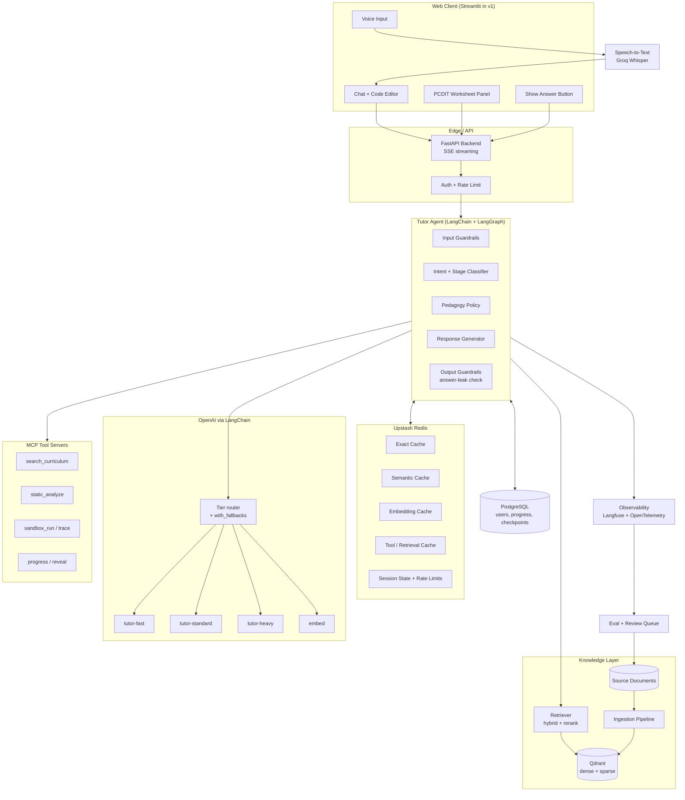
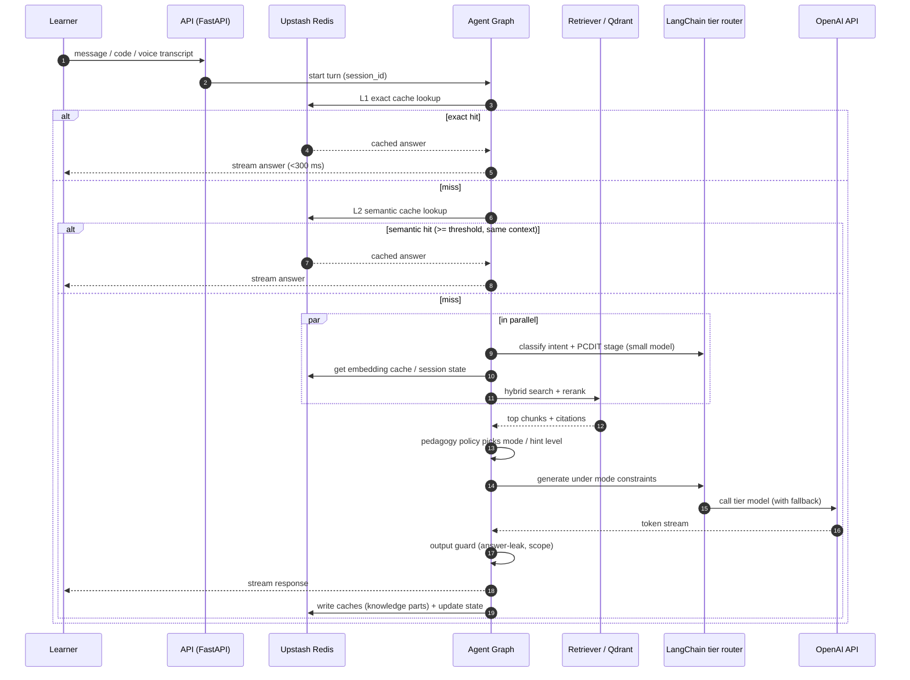
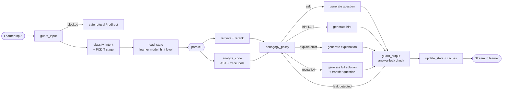
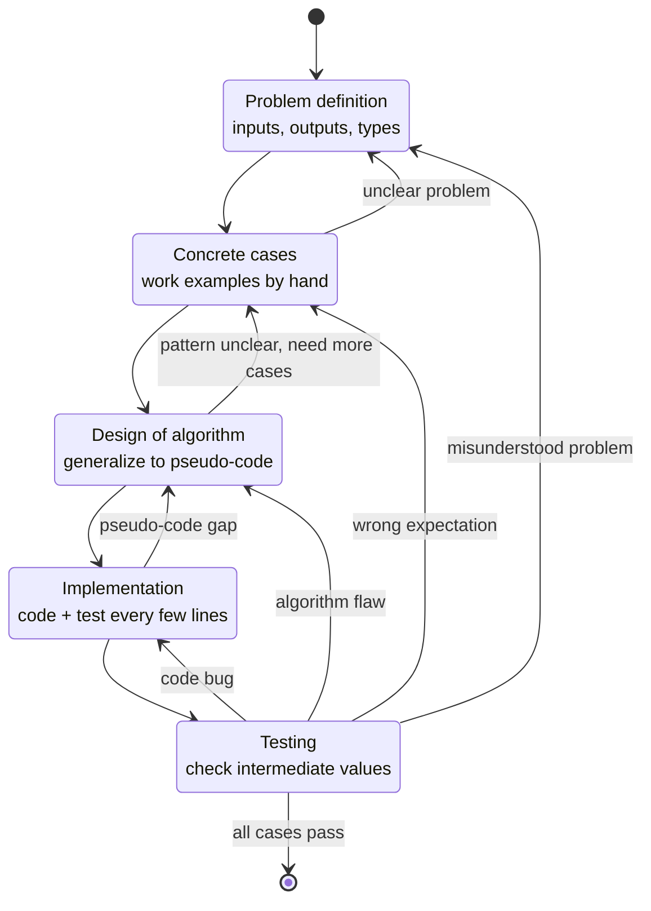
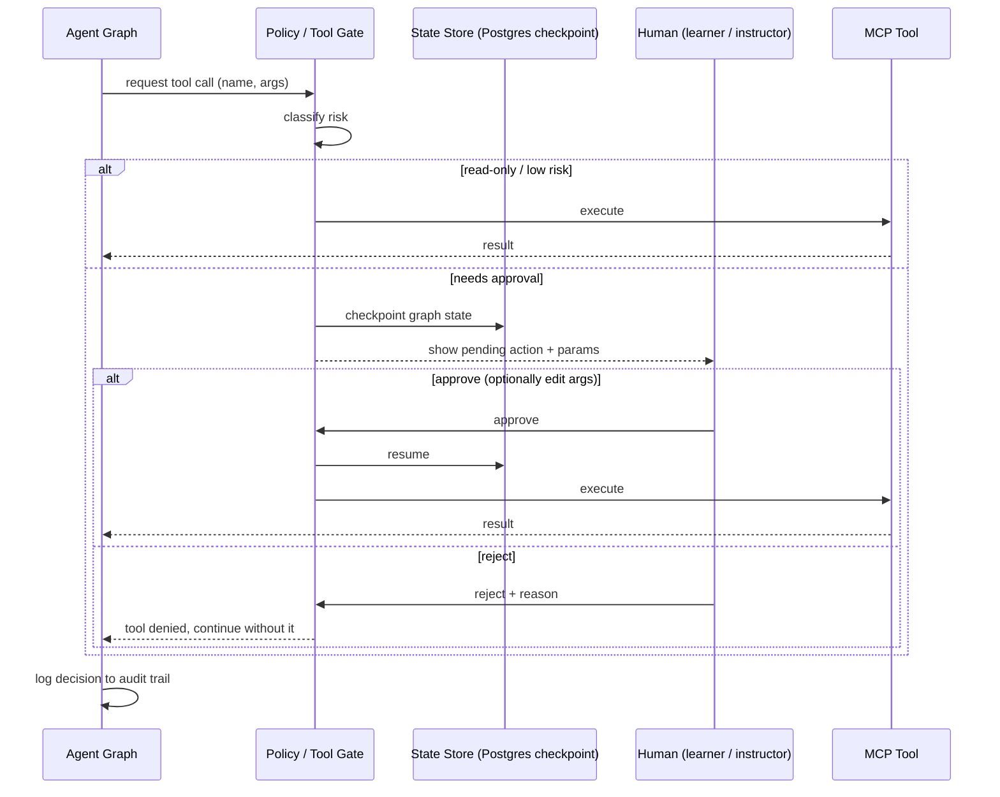
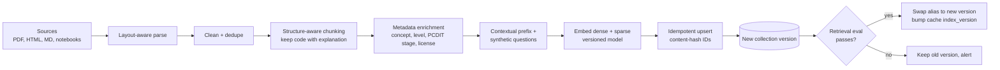
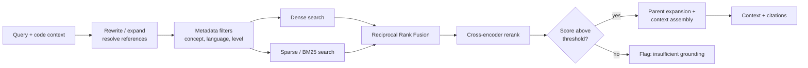
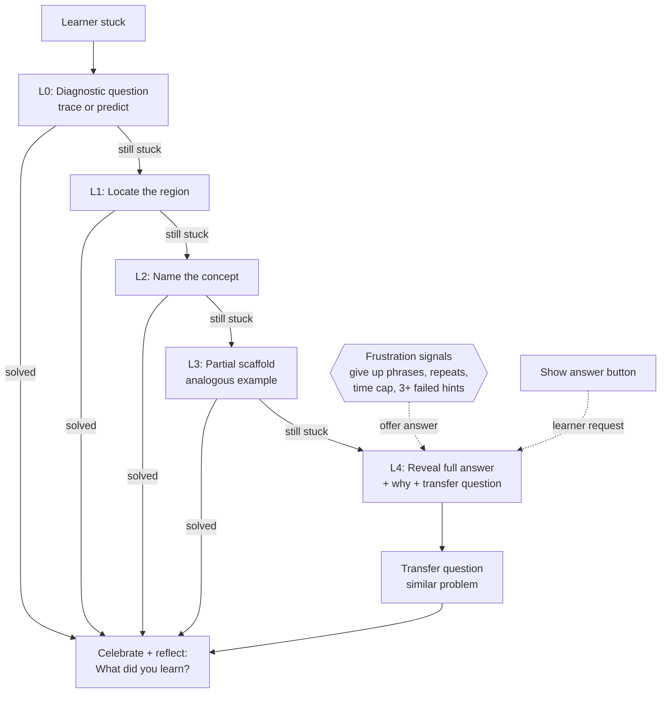
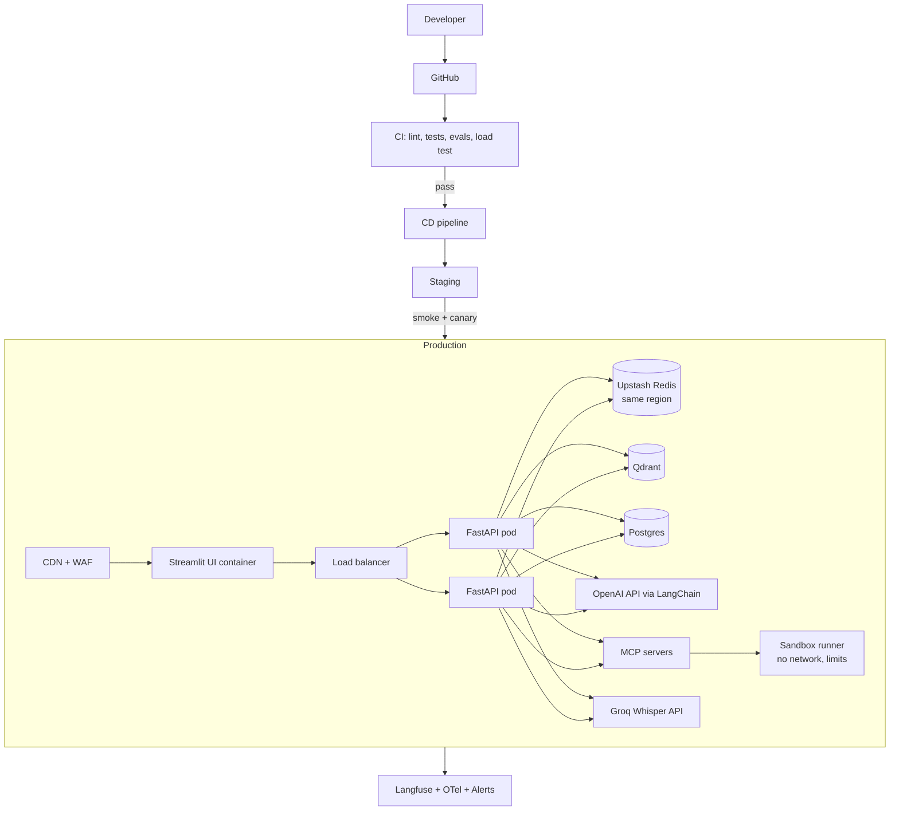

# CodeBuddy — Project Specification

**An end-to-end AI coding tutor built on RAG, the PCDIT framework, and Socratic guidance.**

| | |
|---|---|
| Status | Draft v0.5 |
| Changes in v0.5 | Opt-in long-term learner memory built on mem0 with semantic, episodic, and procedural notes, signed learner tokens, and private-notes-only use (6.1, 8.6, 12.2; ADR 0008); a `SandboxBackend` seam (6.1; ADR 0007); the MCP client is `langchain.mcp`; the real corpus is Think Python v2.0.17 (CC BY-NC 3.0 Unported, stated in the PDF) and the PCDIT paper (19.5, 21). |
| Changes in v0.4 | Slice 1 built; spec aligned with the code: rule-based streaming leak guard with a sampled LLM judge (6, 8.5), Streamlit UI for v1 (14.1, 15), tools over MCP with learner approval (12.3, 12.4), sandbox limits, API hardening, optional semantic cache, and a new implementation-status section (6.1). Code-level docs are in `docs/`. |
| Changes in v0.3 | Package policy for `langchain-classic` vs `langchain-community` (Section 15.2); initial corpus (Think Python, PCDIT paper) split by access type (Sections 9.3, 19.5). Earlier: LLM gateway removed (OpenAI only); STT on Groq Whisper; LangChain integrations (Section 15.1) |
| Date | 2026-10-30 |
| Audience | Product owner, engineers, evaluators |

---

## Table of Contents

1. [Problem Statement](#1-problem-statement)
2. [Goals and Non-Goals](#2-goals-and-non-goals)
3. [Users and Scenarios](#3-users-and-scenarios)
4. [Functional Requirements](#4-functional-requirements)
5. [Non-Functional Requirements](#5-non-functional-requirements)
6. [Solution Overview](#6-solution-overview)
7. [PCDIT Integration](#7-pcdit-integration)
8. [Pedagogy Engine: Socratic Guidance and the Hint Ladder](#8-pedagogy-engine)
9. [RAG System](#9-rag-system)
10. [Latency and Caching Strategy](#10-latency-and-caching-strategy)
11. [LLM Strategy, Routing and Keys](#11-llm-strategy-routing-and-keys)
12. [Agentic Design, MCP, Tool Calling, Human-in-the-Loop](#12-agentic-design)
13. [Speech-to-Text](#13-speech-to-text)
14. [Architecture Diagrams](#14-architecture-diagrams)
15. [Recommended Tech Stack](#15-recommended-tech-stack)
16. [Evaluation Plan](#16-evaluation-plan)
17. [Deployment and Operations](#17-deployment-and-operations)
18. [Security, Privacy, Safety](#18-security-privacy-safety)
19. [Knowledge Sources and Documents](#19-knowledge-sources-and-documents)
20. [Roadmap](#20-roadmap)
21. [Risks and Open Questions](#21-risks-and-open-questions)
22. [Requirements Traceability](#22-requirements-traceability)

---

## 1. Problem Statement

### 1.1 The problem

Novice programmers fail less from lack of syntax knowledge than from lack of **problem-solving process**. They jump straight to code, hit a logical error, and cannot reason about why. Research on the PCDIT framework (Kurniawan et al., *Steps Before Syntax*) attributes this to high cognitive load: learners juggle problem understanding, algorithm design, and syntax simultaneously.

### 1.2 Why existing AI tools make it worse

General-purpose LLM assistants (ChatGPT, Copilot chat) optimize for **giving the answer**. For a learner this causes:

- **Answer dependence.** The learner pastes the error, copies the fix, learns nothing. Skill never transfers to the next problem.
- **No meta-cognition.** Learner never practices predicting, tracing, or checking their own reasoning.
- **Hallucinated or off-level explanations.** Answers use advanced idioms, libraries, or jargon beyond the learner's current knowledge.
- **No curriculum grounding.** The model is not tied to a vetted set of fundamentals, so quality varies.

### 1.3 The opposite failure

Pure Socratic tutors fail too. A learner stuck for 20 minutes who only receives more questions becomes frustrated and quits. The product must **guide first, but never trap the learner**. After bounded effort, it reveals the answer and explains it (see [Section 8](#8-pedagogy-engine)).

### 1.4 Problem in one sentence

> Build a low-latency, grounded AI tutor that teaches core programming fundamentals by guiding learners through PCDIT, asking the right questions instead of handing out answers, and reveals the solution when guidance stops being productive.

---

## 2. Goals and Non-Goals

### Goals

- G1. Teach **core programming fundamentals** (variables, control flow, loops, functions, recursion, arrays/lists, strings, basic data structures, debugging).
- G2. Make the learner do the thinking: Socratic hints, self-explanation, prediction before reveal.
- G3. Map every interaction onto **PCDIT** (Problem definition, Concrete cases, Design of algorithm, Implementation, Testing).
- G4. Explain logical errors in **short, plain language**.
- G5. Respond fast: **p95 time-to-first-token under 1 second**; cache hits under 300 ms.
- G6. Production-grade: observable, evaluated, safe, cost-controlled.
- G7. Never leave a learner stuck: guaranteed escalation to a full worked answer.

### Non-Goals (v1)

- Not a general coding assistant for professionals.
- Not an autograder or plagiarism detector (may integrate later).
- No advanced topics: concurrency, distributed systems, ML.
- No code execution of untrusted code outside a sandbox (see [Section 18](#18-security-privacy-safety)).
- No native mobile apps (responsive web only in v1).

---

## 3. Users and Scenarios

### Personas

| Persona | Description | Need |
|---|---|---|
| **Novice Nina** | First-year CS or bootcamp student, writing Python | Understand why her loop is off by one without being told the fix |
| **Self-taught Sam** | Career changer, learning alone | Structured process, not just answers |
| **Instructor Ines** | Teaches intro programming | Upload course material, see where students struggle |

### Core scenarios

1. **Stuck on a bug.** Nina pastes code and says "my sum is wrong." Tutor asks her to trace the loop with a small input, locates the off-by-one together with her.
2. **Starting a problem.** Sam has a problem statement. Tutor walks PCDIT: identify inputs/outputs, work a concrete example by hand, then generalize.
3. **Voice question.** Nina speaks her question while walking through code on screen; speech is transcribed and answered.
4. **Out of patience.** After several hints Nina clicks "Show me the answer" (or tutor offers it). She gets a full worked solution with explanation and a follow-up check question.
5. **Instructor upload.** Ines uploads a syllabus PDF; it is ingested and the tutor aligns terminology to it.

---

## 4. Functional Requirements

Each requirement has an ID used in [Section 22](#22-requirements-traceability).

| ID | Requirement | Acceptance criteria |
|---|---|---|
| **FR1** | **RAG over programming fundamentals.** Answers grounded in a curated corpus of fundamentals content. | Every explanation cites at least one retrieved source; answers with no supporting retrieval say so rather than guess. |
| **FR2** | **Meta-cognitive guidance.** Tutor does not directly give the answer; it guides the learner to find logical errors independently. | In default mode, first N responses (configurable, default 3 hint levels) contain no corrected code. Verified by automated rubric eval. |
| **FR3** | **Right-question generation.** Tutor asks targeted questions that move thinking toward the error. | Questions are specific to the learner's code/state, one at a time, and map to a PCDIT stage. Rated "helpful" by ≥ 80% of human raters in eval. |
| **FR4** | **Clear error explanations.** Logical errors explained simply and concisely. | Explanation ≤ 120 words, reading level ≤ grade 9, uses learner's own variable names, includes one concrete trace example. |
| **FR5** | **PCDIT integration.** System state machine and prompts follow PCDIT. | Each session tracks current PCDIT stage; questions, hints, and feedback are tagged by stage; learner sees a PCDIT progress view. |
| **FR6** | **Speech-to-text.** Learner can speak questions. | Transcript returned < 1 s after utterance ends (measured); word error rate ≤ 10% on programming vocabulary set; transcript editable before send. |
| **FR7** | **MCP, tool calling, human-in-the-loop.** Tutor can call tools via MCP; sensitive actions require approval. | Tools exposed over MCP; risky tool calls pause for human approval; all calls logged. |
| **FR8** | **Must-have features, optimizations, deployment, evaluation practices.** | Covered by Sections 10, 16, 17. |
| **FR9** | **Best-practice ingestion, vector storage, retrieval.** | Structured chunking, metadata, hybrid search, reranking (Section 9). |
| **FR10** | **Sub-second latency with caching.** Embedding, query, tool-call, and answer caches via Upstash Redis. | p95 TTFT < 1 s; cache hit path < 300 ms (Section 10). |
| **FR11** | **LLM access, fallback, and task routing (OpenAI only, no gateway).** Central key management via secret manager and per-environment projects; fallback between model tiers; small-vs-heavy task routing. | Model or API error triggers in-app fallback with no user-visible failure; tier-to-model mapping lives in config and changes without redeploy (Section 11). |
| **FR12** | **Agentic best practices.** | Bounded loops, typed tools, guardrails, tracing, evals (Section 12). |
| **FR13** | **Mermaid diagrams for architectures and workflows.** | Section 14. |
| **FR14** | **Framework recommendation.** | Section 15. |
| **FR15** | **Anti-frustration escape hatch.** Learner always reaches the answer. | Explicit "Show answer" button always visible after first hint; auto-offer on frustration signals (Section 8.4). |
| **FR16** | **Source documents list.** | Section 19. |

---

## 5. Non-Functional Requirements

| Category | Requirement |
|---|---|
| **Latency** | p95 time-to-first-token < 1000 ms for streamed responses. Semantic-cache hit < 300 ms end to end. Retrieval stage p95 < 150 ms. See honesty note in [10.1](#101-what-under-a-second-means). |
| **Availability** | 99.5% monthly for v1. Model-tier fallback and degraded mode (cached/retrieved explanations) cover an OpenAI outage. |
| **Scalability** | Stateless API pods behind autoscaling; 500 concurrent sessions in v1. |
| **Cost** | Target average LLM cost per session under a configured budget; small model for routine tasks, large model only when needed. |
| **Quality** | Faithfulness ≥ 0.9, context precision ≥ 0.8 on golden set; pedagogy rubric pass rate ≥ 90%. |
| **Accessibility** | WCAG 2.1 AA; keyboard navigable; captions for audio; screen reader friendly. |
| **Privacy** | No learner code or voice used for model training; configurable retention; PII redaction in logs. |
| **Observability** | Trace every request end to end: retrieval, tool calls, LLM calls, cache hit/miss, cost. |
| **Maintainability** | Typed code, CI with eval gates, infrastructure as code. |

---

## 6. Solution Overview

CodeBuddy has four cooperating layers:

1. **Interface layer.** Web app with code editor, chat, voice input, PCDIT progress panel, "Show answer" control.
2. **Tutor agent layer.** A stateful agent (graph) that tracks PCDIT stage, learner history, and hint level, and decides each turn: ask a question, give a hint, explain, or reveal.
3. **Knowledge layer.** RAG over a curated fundamentals corpus plus the PCDIT material, using hybrid retrieval and reranking.
4. **Platform layer.** Upstash Redis caches, LangChain model layer (OpenAI and Groq Whisper), MCP tool servers, observability, evaluation, CI/CD.

### 6.1 Implementation status (v0.5)

Slice 1 is built and tested offline; see `docs/README.md` for the full list and `docs/architecture.md` for the code map.

| Spec area | Status |
|---|---|
| RAG ingestion, hybrid retrieval, corpora split by collection (9) | Built. PDF parsing and the cross-encoder reranker are optional extras and untested on real files |
| Pedagogy engine, hint ladder, anti-frustration (8) | Built, including the streaming guard and a sampled judge |
| PCDIT stage tracking (7) | Stage tracked per turn from the classifier and shown in the UI. The digital worksheet panel and stage-aware error routing are not built |
| Caching (10) | L1, L3, L4, L6 built; L2 semantic built but off by default; L5 not built (tool runs depend on the learner's code) |
| LLM routing (11) | Built as in-app tiers with fallbacks; no gateway (ADR 0001) |
| Agent, MCP, tools, human in the loop (12) | Three tools over MCP, rule-planned, learner approval before code runs, durable checkpoints (SQLite instead of Postgres). Instructor surfaces not built |
| Speech-to-text (13) | Groq Whisper with optional OpenAI fallback behind `/v1/stt`; Streamlit microphone widget with an editable transcript. Utterances are whole recordings, not voice-activity-detected chunks |
| Evaluation (16) | Offline eval and CI gate built. Human review, A/B tests, and the learner pilot are not |
| Learner memory (8.6, 12.2) | Built, off by default and opt-in per learner: mem0 over embedded Qdrant, signed learner tokens, "Forget me", private notes only. Concept mastery, solved detection, Postgres persistence, and accounts are not built. See `docs/memory.md` |
| Sandbox backends (12.4, 18) | A `SandboxBackend` seam with the subprocess sandbox as the only backend (ADR 0007). No remote adapter is included or tested |
| Security and operations (17, 18) | API keys, rate limits, CORS, metrics, sandbox, Dockerfile and compose (untested). No Langfuse, accounts, or deployment automation |

### Key design principle

**Retrieval grounds content; pedagogy policy controls disclosure.** The knowledge layer finds *what is true*. The pedagogy policy decides *how much of it to reveal right now*. This separation keeps the model from leaking the answer just because it has it in context.

### Turn flow in brief

1. Learner sends text, code, or voice.
2. Input guardrails and intent classification (small model).
3. Cache lookup (exact then semantic).
4. If miss: retrieve, rerank, analyze code (tools), consult learner state.
5. Pedagogy policy picks response mode (question, hint level 1–4, explanation, reveal).
6. Generator (OpenAI model tier chosen by policy) produces a streamed response under that mode's constraints.
7. Output guard: a rule-based check runs on the token stream and blocks corrected code at hint levels 0 to 3 (Section 8.5). An LLM judge audits a sample of replies afterwards.
8. Update learner state, write cache, emit traces.

---

## 7. PCDIT Integration

### 7.1 What PCDIT is

PCDIT is a non-linear problem-solving framework from Oka Kurniawan et al. (*Steps Before Syntax: Helping Novice Programmers Solve Problems using the PCDIT Framework*, arXiv:2109.08896; framework page: okakurniawan.net/pcdit-framework). It scaffolds the path from a problem description to a tested program, putting thinking before syntax to reduce cognitive load.

| Stage | Meaning | Learner activity |
|---|---|---|
| **P** | Problem definition | Identify inputs, outputs, data types; restate problem in natural language |
| **C** | Concrete cases | Work specific examples by hand, step by step, from input to output |
| **D** | Design of algorithm | List the steps from the cases, find patterns, generalize to pseudo-code; iterate |
| **I** | Implementation | Translate pseudo-code to code, testing every few lines |
| **T** | Testing | Check against concrete cases, including intermediate values, to find and fix errors |

PCDIT is **non-linear**: learners move back and forth (e.g., a failing test sends them back to Concrete cases or Design). The system must not force a one-way pipeline.

> Note: stage descriptions above are taken from the public framework page and abstract. The full paper should be read before finalizing prompts (see open questions, [Section 21](#21-risks-and-open-questions)). The authors also publish a PCDIT worksheet and a PCDIT chatbot; consider reviewing them for alignment and, for any reuse, obtaining permission.

### 7.2 How the system uses PCDIT

1. **Stage tracking.** Session state holds `current_stage` and a history of transitions. A small classifier infers stage from learner messages and artifacts (worksheet fields, code state).
2. **Stage-specific question banks.** Each stage has question templates, retrieved and adapted by the model:
   - P: "What goes in? What should come out? What type is each?"
   - C: "Pick a small input. What should the output be? Walk it through by hand—what happens at step one?"
   - D: "Look at the steps you wrote. What repeats? Can you say it in one general sentence?"
   - I: "Which three lines can you write and test first?"
   - T: "What value did you expect for `total` after iteration 2? What did the program actually have?"
3. **Digital PCDIT worksheet.** Interactive panel with fields per stage; learner's entries feed the agent as structured state.
4. **Stage-aware error routing.** A logical error found in Testing is mapped back to the likely originating stage (e.g., wrong output on case 2 → revisit Concrete cases or Design) and the tutor steers the learner there.
5. **Corpus alignment.** PCDIT material is indexed with `pcdit_stage` metadata so retrieval can filter by stage.
6. **Evaluation tie-in.** Rubrics score whether the tutor's turn matches the learner's actual stage and moves them forward (Section 16).

### 7.3 PCDIT state machine

See diagram in [Section 14.4](#144-pcdit-state-machine).

---

## 8. Pedagogy Engine

This is the product's differentiator. It is implemented as an explicit **policy layer**, not left to model discretion.

### 8.1 Principles

- **Ask before tell.** Prefer a question that surfaces the gap.
- **One question at a time.** Multi-question responses overwhelm novices.
- **Prediction before reveal.** "What do you think this prints?" before showing output.
- **Self-explanation.** Ask the learner to explain in their own words.
- **Minimal sufficient hint.** Reveal the least information that moves them forward.
- **Respect effort.** Credit correct reasoning; do not just point out mistakes.

### 8.2 The hint ladder

| Level | Name | Content | Contains corrected code? |
|---|---|---|---|
| 0 | **Diagnostic question** | Ask learner to trace or predict ("What is `i` on the last pass?") | No |
| 1 | **Locate** | Narrow to region ("Look closely at the loop condition") | No |
| 2 | **Name the concept** | Identify the concept at fault ("This is an off-by-one: loop bounds") with retrieved explanation | No |
| 3 | **Partial scaffold** | Pseudo-code or a worked analogous example (different problem) | No (analogous only) |
| 4 | **Reveal** | Full corrected solution + explanation of why the bug happened + a transfer question | Yes |

Level advances when the learner is still stuck after an attempt, or on request. Level never auto-skips past 0 on a first turn unless the learner explicitly asks to see the answer.

### 8.3 Logical-error explanation format (FR4)

Every error explanation uses a fixed short template to stay clear and concise:

1. **What happens** (one sentence, learner's own names).
2. **Why** (one sentence, the underlying concept).
3. **Tiny trace** (3–5 lines showing variable values on a small input).
4. **Check question** (one question to confirm understanding).

Constraints: ≤ 120 words, no unexplained jargon, no more than one new concept per turn.

### 8.4 Anti-frustration design (FR15)

The learner should never feel trapped. Mechanisms:

- **Always-visible "Show answer"** after the first hint. No justification required. Optional soft confirm: "Want one more hint first, or see the full answer?"
- **Frustration signals** trigger an offer to reveal: repeated identical submissions, ≥ 3 hints without progress, time-on-problem threshold, explicit phrases ("I give up", "just tell me", "this is stupid"), rapid-fire short messages.
- **Escalation guarantee.** Hard cap: the hint ladder reaches Level 4 within a configurable budget (default: 4 tutor turns or 10 minutes on the same problem), at which point the tutor proactively offers the answer.
- **Tone.** Warm, encouraging, never condescending. Normalizes struggle ("This bug trips up most people").
- **Reveal is a teaching moment.** Answer comes with explanation, then a **transfer question** on a slightly different case, so reveal still builds skill.
- **Learner control.** Settings let learners choose "more guidance" or "faster answers"; instructors can set defaults per course.
- **Track outcomes.** Reveal rate, time-to-reveal, and post-reveal transfer success are product metrics (Section 16).

### 8.5 Answer-leak guard

A rule-based check on the token stream blocks corrected code in Levels 0–3. Prose is released as soon as its first word shows it cannot start a code line; lines that look like code are held until the line ends. On a violation the reply stops and a safe question for the current PCDIT stage is appended (a retrieved concept-only explanation is the planned alternative).

A blocking LLM judge was dropped from the reply path because it needs the whole reply and would break the time-to-first-token target (ADR 0002). Instead a configurable sample of hint replies is re-checked by the fast model after the reply is sent, to catch leaks written in prose such as "change the +1"; results are counted at `/v1/metrics`. Known blind spot of the rule check: prose-only fixes and indented code without a fence or keyword.

### 8.6 Learner model

> **Built in v0.5 through mem0.** Long-term memory is opt-in per learner and identified by a signed learner token, not an account. mem0 runs over embedded Qdrant. Kinds map as follows: *semantic* is facts mem0 extracts from recent turns; *episodic* is one line per reveal (stage, hints used, outcome), written by our code; *procedural* is mem0's procedural memory, summarizing how the learner worked through a problem, written after a reveal. Recall runs in parallel with classification and retrieval under a 0.6 s timeout; writes run in the background on a reveal and every fourth hint. Memory reaches the model only as delimited private notes. It never changes the hint level or mode, never bypasses the leak guard, and bypasses the answer caches. Not built: concept-mastery scores, pace and modality preferences, solved detection, Postgres persistence. See `docs/memory.md` and ADR 0008.

Per-learner state (target design; stored in Redis for the session, persisted to Postgres):

- Concept mastery estimates (simple Bayesian or Elo-like update per concept tag).
- Error history (recurring error types).
- Hint-level history and reveal count.
- Preferred pace and modality (text vs voice).

Used to pick question difficulty and to avoid re-explaining mastered concepts.

---

## 9. RAG System

### 9.1 Scope

Focus strictly on **core programming fundamentals**. Out-of-scope queries get a polite redirect or a short answer flagged as outside the curated corpus.

### 9.2 Data ingestion pipeline (FR9)

1. **Collect** from sources in [Section 19](#19-knowledge-sources-and-documents); record license and provenance per document.
2. **Parse** with a layout-aware parser. Convert PDFs (books, arXiv papers) to Markdown with Docling (or Marker) so headings, code blocks, and tables survive. Parse HTML and notebooks with LangChain loaders. Chunking (step 4) depends on this structure, so a plain-text PDF dump is not acceptable.
3. **Clean and normalize.** Strip boilerplate, fix encoding, dedupe near-duplicates (MinHash or embedding similarity).
4. **Chunk** with structure awareness:
   - Split on headings and semantic boundaries, not fixed character counts alone.
   - Target 200–500 tokens per chunk with small overlap (10–15%).
   - **Never split a code block** from its explanation.
   - Keep parent-child relationship: small chunks indexed for retrieval, parent section returned for context (small-to-big retrieval).
5. **Enrich with metadata**: `concept` (e.g., loops, recursion), `language`, `difficulty` (beginner/intermediate), `pcdit_stage`, `content_type` (explanation, example, common-bug, exercise), `source`, `license`, `version`, `updated_at`.
6. **Contextual chunk augmentation.** Prepend a one-line context ("From 'Loops' chapter of X, about off-by-one errors") before embedding to improve retrieval.
7. **Generate synthetic questions** per chunk (hypothetical questions learners would ask) and index alongside chunks to bridge the vocabulary gap between novice phrasing and textbook phrasing.
8. **Embed** in batches with a versioned embedding model; store `embedding_model_version`.
9. **Upsert** idempotently using content hash as ID, so re-ingestion is cheap and safe.
10. **Quality gate.** Run retrieval smoke tests on the golden set before promoting a new index version (blue/green index swap via alias).

### 9.3 Vector storage

- **Primary vector DB**: Qdrant (self-hosted or Qdrant Cloud). Supports dense + sparse vectors, payload filtering, quantization, and multi-tenancy. Alternative for simplicity: Upstash Vector (serverless, same vendor as Redis) or pgvector if the team wants one fewer system.
- **Corpora separated by access type:** `fundamentals` (learner-facing, citable), `pedagogy` (tutor-only, never quoted to learners), `tenant_<id>` (instructor uploads, filter-enforced). Separation is done by collection, not by prompt instruction, so the model cannot leak what it never retrieves.
- **Collection design**:
  - One collection per embedding model version; alias points to the active one.
  - Dense vector + sparse (BM25/SPLADE) vector per chunk for native hybrid search.
  - Payload indexes on `concept`, `language`, `difficulty`, `pcdit_stage`, `content_type`.
- **Performance**: HNSW index; scalar or binary quantization with rescoring if memory-bound; keep vectors in RAM, payload on disk when large.
- **Tenancy**: per-course/instructor uploads isolated via a tenant payload field with filter-enforced access.

### 9.4 Retrieval pipeline

```
query → rewrite/expand → hybrid search (dense + sparse, filtered) → fuse (RRF)
      → rerank (cross-encoder) → parent expansion → context assembly
```

1. **Query understanding** (small model): classify intent (concept question, debug help, problem-start), extract concepts, detect language, resolve references from conversation ("it", "that loop").
2. **Query rewriting**: standalone question; optionally multi-query or HyDE for vague queries.
3. **Metadata filtering**: filter on inferred `concept`, `language`, `difficulty ≤ learner level`, optionally `pcdit_stage`.
4. **Hybrid search**: dense + sparse, top 30–50 candidates each, fused by Reciprocal Rank Fusion.
5. **Rerank**: self-hosted cross-encoder (e.g., BGE reranker, or FlashRank via LangChain's contextual compression retriever) down to top 4–6. No extra paid API.
6. **Parent expansion**: swap in parent sections where useful.
7. **Context assembly**: dedupe, order, token-budget the context, attach citations.
8. **Relevance threshold**: if best rerank score is below threshold, return "insufficient grounding" and let the agent say so or use a general-knowledge fallback flagged as ungrounded.

### 9.5 Code-aware retrieval

Learners' code is part of the query. The system:

- Extracts structural features with an AST parser (loops, conditionals, function signatures) and error traces.
- Maps them to concept tags and retrieves "common-bug" chunks matching the pattern (e.g., `range(len(x)+1)` → off-by-one).
- Keeps a **bug-pattern knowledge base**: pattern, symptom, explanation, Socratic questions that lead to it. This directly powers FR3.

### 9.6 Grounding and citation

- Every explanation carries source references shown to the learner ("From: Think Python, ch. 7").
- Generator prompt: answer only from provided context for factual claims; say so when context is insufficient.
- Faithfulness checked offline and sampled online (Section 16).

### 9.7 Index freshness and versioning

- Scheduled re-ingestion; content-hash diffing to update only changed chunks.
- Index and embedding versions recorded; cache keys include the index version so stale answers are invalidated automatically on content change.

---

## 10. Latency and Caching Strategy

### 10.1 What "under a second" means

Honest framing: a large-model response generated in full will rarely finish in under 1 second. The requirement is therefore defined as:

- **p95 time-to-first-token (TTFT) < 1000 ms** for streamed responses (the learner sees text begin within a second).
- **Cache-hit responses complete in < 300 ms.**
- Non-LLM stages (cache lookup, retrieval, rerank) have strict budgets below.

### 10.2 Latency budget (cache-miss path)

| Stage | Budget (p95) |
|---|---|
| Edge + auth + input guardrail | 40 ms |
| Intent classify (small model, or rule-first) | 120 ms, run **in parallel** with retrieval |
| Embedding (cached or fast model) | 60 ms |
| Vector hybrid search | 60 ms |
| Rerank | 80 ms |
| Prompt assembly | 10 ms |
| LLM TTFT (small/fast model, streaming) | 500 ms |
| **Total to first token** | **≈ 850 ms** |

Design implications: parallelize independent steps, use a fast model for the first token, stream everything, and keep services in one region.

### 10.3 Upstash Redis cache layers

Upstash Redis is serverless, accessed over REST or Redis protocol, with global replication options—suitable for serverless/edge deployments. Layers:

| Layer | Key | Value | TTL | Notes |
|---|---|---|---|---|
| **L1 Exact query cache** | hash(normalized query + learner level + mode + index_version) | Final answer text + citations | 24 h – 7 d | Normalize whitespace/case; short-circuits everything |
| **L2 Semantic cache** | Query embedding (nearest neighbor ≥ similarity threshold, e.g. 0.95) | Answer for similar question | 24 h – 7 d | Via Upstash Vector or Redis vector search; **strict threshold**, scoped by concept and language |
| **L3 Embedding cache** | hash(text + embedding_model_version) | Vector | 30 d | Avoids re-embedding repeated queries/chunks |
| **L4 Retrieval cache** | hash(rewritten query + filters + index_version) | Ranked chunk IDs | 1–6 h | Skips search and rerank |
| **L5 Tool-result cache** | hash(tool name + args) | Tool output | Per-tool (e.g., docs lookup 24 h, static analysis 10 min) | Only for **idempotent, read-only** tools |
| **L6 Session/learner state** | session_id | Conversation, PCDIT stage, hint level | Session TTL (e.g., 2 h) | Fast state access; persisted to Postgres |
| **Rate limiting** | user/IP | Counter | Sliding window | `@upstash/ratelimit` |

### 10.4 Caching rules specific to a tutor (important)

Naive answer caching conflicts with the pedagogy engine. Rules:

- **Cache by pedagogical context, not just text.** The correct response to "why is my sum wrong?" differs by hint level, stage, and learner history. Keys include `hint_level` and `mode`.
- **Cache the knowledge, personalize the delivery.** Safe-to-cache: concept explanations, retrieval results, bug-pattern lookups, tool outputs, general question banks. Generate personalization (the actual Socratic question about *this learner's code*) fresh—but with a small model and cached context, which is fast.
- **Never cache Level 4 reveals** across different user code (the answer depends on the code). Cache only code-independent artifacts.
- **Cache hits for repeated identical questions** (e.g., FAQ-style "what is recursion?") are the high-value case.
- **Invalidate** on index version change, prompt version change, or model change (all included in key).
- **Stampede protection**: single-flight lock (`SET NX`) so concurrent identical misses trigger one generation.
- **Provider prompt caching**: structure prompts with a long static prefix (system prompt, pedagogy rules, few-shot examples) so OpenAI's automatic prompt caching (applies to long repeated prefixes; verify current thresholds) reduces TTFT and cost.
- **Cache warming**: pre-compute answers for top-N curriculum questions and concepts at deploy time.
- **Metrics**: hit rate per layer, semantic-cache false-positive rate (sampled and reviewed), latency saved.

### 10.5 Other latency optimizations

- Stream tokens via SSE/WebSocket; render progressively.
- Speculative/parallel execution: retrieval and intent classification run concurrently.
- Co-locate API, Redis, and vector DB in the same region; reuse HTTP connections.
- Use small models for routing/classification/guardrails; keep prompts short.
- Quantized vectors and tuned HNSW `ef` for retrieval speed.
- Optimistic UI and STT interim results to hide remaining latency.
- Load test with k6 or Locust in CI; fail build if p95 regresses.

---

## 11. LLM Strategy, Routing and Keys

### 11.1 Decision: OpenAI only, no gateway (FR11)

v1 uses **OpenAI as the only LLM provider**, called through LangChain (`langchain-openai`). No LLM gateway service. Reasons: one vendor, one SDK, one bill, one set of eval baselines, and no extra service in the latency path.

What a gateway would have provided, and where it now lives:

| Gateway feature | v1 replacement |
|---|---|
| Central API-key management | Keys in secret manager; separate OpenAI project per environment (dev / staging / prod) |
| Budgets | Monthly limits on each OpenAI project; per-user and per-session budgets as Redis counters in the app (OpenAI does not enforce per-end-user budgets) |
| Fallback routing | Tier fallback with LangChain `.with_fallbacks()` (Section 11.4) |
| Task routing (small vs heavy) | Tier-to-model mapping in config (Sections 11.2–11.3) |
| Retries and timeouts | `ChatOpenAI(max_retries=..., timeout=...)` |
| Logging and cost attribution | Langfuse callback tags (tier, task class, hashed user) |

**Accepted trade-off:** a full OpenAI outage is not survived by switching provider. It is survived by degraded mode (Section 11.4). If that is unacceptable (open question 8), add a second provider behind the same LangChain chat-model interface. Application code does not change, only config and the model class.

### 11.2 Model tiers (config, not code)

| Tier | Tasks | OpenAI model class | Notes |
|---|---|---|---|
| `tutor-fast` | Intent and stage classification, query rewrite, guardrails, answer-leak judge | Small, low-latency model (mini class) | Runs on nearly every turn; cost-critical |
| `tutor-standard` | Socratic questions, hint levels 0–3, error explanations | Mid-tier model (full-size, non-reasoning class) | Must meet TTFT budget |
| `tutor-heavy` | Level 4 worked solutions, complex bug diagnosis, eval judging | Most capable model available at build time | Latency tolerated; correctness first |
| `embed` | Chunks and queries | `text-embedding-3-small` (or `-large` if benchmark justifies) | Versioned |

Exact model IDs are pinned in config at build time after checking OpenAI's current model list. The spec does not pin IDs because they change.

```yaml
tiers:
  tutor-fast:     { model: <small-model-id>,    timeout_s: 1.5, max_retries: 2, fallback: [] }
  tutor-standard: { model: <mid-model-id>,      timeout_s: 2.0, max_retries: 2, fallback: [tutor-fast] }
  tutor-heavy:    { model: <flagship-model-id>, timeout_s: 15,  max_retries: 1, fallback: [tutor-standard] }
```

```python
from langchain_openai import ChatOpenAI

fast = ChatOpenAI(model=FAST_ID, timeout=1.5, max_retries=2)
standard = ChatOpenAI(model=STD_ID, timeout=2.0, max_retries=2).with_fallbacks([fast])
heavy = ChatOpenAI(model=HEAVY_ID, timeout=15, max_retries=1).with_fallbacks([standard])
```

### 11.3 Task-based routing

| Task class | Examples | Model tier | Why |
|---|---|---|---|
| Task class | Examples | Tier | Why |
|---|---|---|---|
| **Small / fast** | Intent classification, stage detection, query rewrite, guardrail checks, answer-leak judge, cache-key normalization | `tutor-fast` | Low latency and cost |
| **Standard** | Socratic question generation, hint levels 0–3, error explanation | `tutor-standard` | Good reasoning at sub-second TTFT |
| **Heavy** | Level 4 full worked solutions, complex multi-step bug diagnosis, ambiguous code, eval judging | `tutor-heavy` | Correctness matters most; latency tolerated |
| **Embedding** | Chunks, queries | `embed` | Versioned |
| **Rerank** | Candidate reranking | Local cross-encoder (not an LLM call) | Latency-critical, no API hop |
| **STT** | Speech | Groq Whisper (Section 13) | Separate provider |

Callers ask for a **task class**, never a model name. Policy maps class → tier, and tier → model comes from config. Upgrading a model is a config change, not a code change.

### 11.4 Fallback and resilience (in-app)

- **Retries:** `max_retries` with exponential backoff on 429 and 5xx, built into `ChatOpenAI`.
- **Timeouts:** per-tier timeout so fallback fires before the latency budget is spent (e.g., 1.5 s on `tutor-fast`).
- **Tier fallback:** `heavy → standard → fast`. A lower tier answers instead of failing. Responses served by a fallback tier are tagged `degraded_model=true` in traces.
- **Circuit breaker:** LangChain does not provide one. Build a small breaker with an Upstash Redis counter and TTL: after N failures in a window, skip OpenAI for 30–60 s and go straight to degraded mode.
- **Context-window overflow:** choose a larger-context model at routing time when the assembled prompt exceeds the budget. Keep prompts short by design (Section 9.4, step 7).
- **Degraded mode:** if all tiers fail, serve a cached or retrieved concept explanation (no generation) with a visible notice and a retry button. Never show a blank error.

### 11.5 Keys and budgets

- OpenAI and Groq keys live only in the secret manager. The app reads them from environment at startup; rotation is a secret update plus restart, no code change.
- One OpenAI project per environment, each with a monthly budget and alert set in the OpenAI dashboard.
- Per-user and per-session token budgets enforced in the app with Upstash Redis counters (daily caps; rate limits via `@upstash/ratelimit`).
- Cost attribution: Langfuse tags per request (tier, task class, hashed user ID, session).
- Alerts on spend anomalies and on fallback-rate spikes (a spike usually means OpenAI is degrading).

---

## 12. Agentic Design

### 12.1 Agent architecture

The tutor is a **stateful graph** (workflow with bounded agentic steps), not a free-running autonomous agent. Deterministic structure where the pedagogy must be reliable; model discretion only where flexibility helps.

Nodes (see diagram in [14.3](#143-tutor-agent-graph)):

- `guard_input` → `classify_intent` → `load_state` → `retrieve` / `analyze_code` (parallel) → `pedagogy_policy` → `generate` → `guard_output` → `update_state`.

### 12.2 Best practices applied

| Practice | Application |
|---|---|
| **Prefer workflows over open-ended agents** | Fixed graph; loops are bounded (max tool iterations, e.g., 3). |
| **Typed, narrow tools** | Each tool has a JSON schema, clear description, validated inputs/outputs. |
| **Least privilege** | Tools get minimum permissions; read-only by default. |
| **Human-in-the-loop for risk** | Approval gates (Section 12.4). |
| **Guardrails at input and output** | Prompt-injection screening, scope checks, answer-leak checks, PII redaction. |
| **Separation of policy from generation** | Pedagogy decisions in code; model just verbalizes under constraints. |
| **Structured outputs** | JSON-schema outputs for classification and routing; validated with Pydantic. |
| **State management and checkpointing** | Persisted graph state allows resume, replay, and human interrupts. |
| **Observability** | Full traces per node and tool call; prompt/version tagging. |
| **Evals as tests** | Golden datasets and rubric evals run in CI; regressions block deploy. |
| **Failure handling** | Timeouts, retries, fallbacks, graceful degradation, idempotent tools. |
| **Prompt versioning** | Prompts stored in version control / prompt registry with A/B support. |
| **Cost and step budgets** | Max tokens, max steps, per-session spend caps. |
| **Memory discipline** | Short-term conversation window + summarized long-term learner model; no unbounded context. Built in v0.5: the six most recent messages plus at most five recalled notes of 200 characters each, opt-in, never read by the policy, never cached. |
| **Prompt-injection defense** | Treat retrieved text, learner code, and tool outputs as untrusted data; never as instructions. |

### 12.3 MCP and tool calling (FR7)

**Model Context Protocol (MCP)** standardizes how the agent discovers and calls tools and resources. CodeBuddy acts as an MCP **client** to its own and third-party MCP **servers**.

Proposed MCP servers/tools:

| Tool | Description | Risk | Approval |
|---|---|---|---|
| `search_curriculum(query, filters)` | RAG retrieval | Read-only | None |
| `get_bug_pattern(code_features)` | Bug-pattern lookup | Read-only | None |
| `static_analyze(code, language)` | AST/lint analysis, no execution | Read-only | None |
| `run_code_sandboxed(code, tests, timeout)` | Execute learner code in isolated sandbox (no network, CPU/mem/time limits) | Medium | Policy-gated; auto for small learner snippets, logged |
| `trace_execution(code, input)` | Step-by-step variable trace (feeds the "tiny trace" and Concrete-cases stage) | Medium | As above |
| `generate_test_cases(spec)` | Suggest concrete cases | Read-only | None |
| `save_progress(learner_id, data)` | Persist learner model | Write | None (own data) |
| `reveal_solution(problem_id)` | Return reference solution | Pedagogically sensitive | Policy check (ladder level / explicit learner request) |
| `instructor_publish_material(doc)` | Add course material to corpus | Write, shared | **Human approval (instructor/admin)** |
| `send_report_to_instructor(...)` | Share learner data with a third party | Privacy-sensitive | **Learner consent + approval** |

MCP practices: pin server versions, authenticate (OAuth/API keys), scope per user, validate all inputs, log every call, rate limit, and treat tool descriptions from third-party servers as untrusted.

> **Built in v0.4.** `analyze_python` (read), `suggest_cases` (read), and `trace_python` (execute) are served over MCP stdio and called through `langchain.mcp`. Rules, not the model, choose tools. `trace_python` runs the learner's code in an allowlist-based sandbox with resource limits and, where the host allows, no network; this is defense in depth and not a security boundary (ADR 0006). The remaining table rows (`save_progress`, `reveal_solution`, `instructor_publish_material`, `send_report_to_instructor`) are not built; the `write_shared` risk class exists and never auto-runs.

### 12.4 Human-in-the-loop (HITL)

Three distinct HITL surfaces:

1. **Learner-in-the-loop (pedagogical).** The learner controls pacing: confirm before reveal, choose hint level, edit voice transcripts, approve code execution if configured. This is part of the product design, not just safety.
2. **Approval gates for risky tool calls.** (Built for running learner code: the graph pauses with `interrupt()`, the API sends an `approval` event, and `POST /v1/approve` resumes the same turn. Approvals are single-use and bound to the owning session.) Graph `interrupt` pauses execution, persists state, shows the pending action and parameters, and resumes on approve / edit / reject. Applies to writes affecting shared data or third parties.
3. **Instructor/expert review loop (quality).** Flagged low-rated, low-faithfulness, or answer-leak-suspected conversations go to a review queue; reviewed items become new golden test cases and bug-pattern entries. Instructors can approve corpus additions and edit canned Socratic questions.

### 12.5 Agent workflow loop

See sequence diagram in [14.5](#145-hitl-approval-flow).

---

## 13. Speech-to-Text

### 13.1 Requirements

- Fast transcription. Groq Whisper is a batch API, so the client cuts audio into utterances (voice activity detection) and sends each one. Target: transcript within 1 s of utterance end (measure, don't assume).
- Good accuracy on programming vocabulary ("for loop", "i plus plus", "null pointer", "list comprehension", identifiers). Pass a programming vocabulary list via Whisper's `prompt` parameter to bias recognition.
- Accents and non-native English speakers common in the user base.
- Editable transcript before sending (also a metacognitive moment: re-reading their own question).

### 13.2 Options

| Option | Pros | Cons |
|---|---|---|
| **Groq Whisper API** (`whisper-large-v3-turbo`, `whisper-large-v3`) — **recommended** | Very fast hosted Whisper; one API key; `prompt` parameter biases toward programming vocabulary; low cost | Batch (file or chunk upload), not a native streaming API; file size and rate limits apply (check current limits) |
| **OpenAI `gpt-4o-transcribe`** | Same vendor as the LLM; good accuracy | Slower than Groq on short clips; used as fallback |
| **faster-whisper (self-hosted)** | Private; no per-minute cost | GPU/CPU ops burden |
| **Browser Web Speech API** | Free, no backend | Browser-dependent, weak control, privacy depends on browser |

**Recommendation:** Groq Whisper as primary, OpenAI transcription as fallback, both behind one internal interface (`transcribe(audio) -> text`) so providers swap without touching the turn pipeline. Deepgram and AssemblyAI are dropped from v1 to keep the vendor count down.

### 13.3 Flow

1. Browser records audio (MediaRecorder) and uses voice activity detection to end each utterance on pause.
2. Utterance is uploaded to the FastAPI `/stt` endpoint, which calls Groq Whisper (`whisper-large-v3-turbo`) with a programming-vocabulary `prompt`. On error or timeout it falls back to OpenAI transcription behind the same interface.
3. Post-processing: programming-term normalization ("i plus plus" → `i++`), punctuation, optional code-symbol mapping.
4. Transcript shown in input box; learner edits and sends (or auto-send after confirmation setting).
5. Transcript flows into the standard turn pipeline.

Optional (later): text-to-speech for tutor questions, with captions, for accessibility.

---

## 14. Architecture Diagrams

### 14.1 System architecture



### 14.2 Single-turn request workflow



### 14.3 Tutor agent graph



### 14.4 PCDIT state machine



### 14.5 HITL approval flow



### 14.6 Ingestion pipeline



### 14.7 Retrieval pipeline



### 14.8 Hint ladder and anti-frustration flow



### 14.9 Deployment architecture



---

## 15. Recommended Tech Stack

Selected for **simplicity, popularity, and production readiness**. Prefer boring, well-documented tools.

| Concern | Recommendation | Why | Alternatives |
|---|---|---|---|
| **Frontend** | **Streamlit** for v1 (thin client over the SSE API, ADR 0003) | Fastest path to a testable UI; microphone and chat widgets built in | Next.js (React) + TypeScript + Tailwind + Monaco editor when a richer editor is needed; the API contract does not change |
| **Streaming UI** | `st.write_stream` over the SSE client | Built into Streamlit | Vercel AI SDK with a Next.js front end |
| **Backend API** | **FastAPI (Python)** + Pydantic | Python is the ML/RAG ecosystem default; async, typed, auto OpenAPI | Node/NestJS |
| **Agent orchestration** | **LangGraph** on **LangChain** | Stateful graphs, checkpointing, interrupts (HITL) built in; LangChain supplies model, tool, and retriever integrations | Plain Python state machine (simplest), PydanticAI, OpenAI Agents SDK |
| **RAG toolkit** | **LangChain** loaders, splitters, retrievers, vector store integrations (Section 15.1) | Fewest custom pieces; language-aware code splitting | LlamaIndex (stronger indexing abstractions), Haystack |
| **Document parsing** | **Docling** (PDF to Markdown, keeps headings and code blocks); LangChain `langchain-community` loaders for HTML and notebooks | Structure-aware chunking needs structure preserved | Marker, Unstructured |
| **Vector DB** | **Qdrant** via `langchain-qdrant` (hybrid mode) | Hybrid search, filtering, quantization, simple ops | Upstash Vector, pgvector, Weaviate |
| **Cache / state / rate limit** | **Upstash Redis** (+ `@upstash/ratelimit`; LangChain Upstash cache and chat-history integrations) | Serverless, per-request pricing, low-latency global reads, REST access | Redis Cloud, self-hosted Redis |
| **Relational DB** | **PostgreSQL** (Neon/Supabase/RDS) | Users, progress, checkpoints, audit | SQLite for prototype |
| **LLM provider** | **OpenAI API** via `langchain-openai` (`ChatOpenAI`, `OpenAIEmbeddings`); no gateway in v1 | One vendor, one SDK, built-in retries and `.with_fallbacks()` | LiteLLM Proxy, or a second provider behind the same LangChain interface if open question 8 requires it |
| **Tool protocol** | **MCP** (official Python/TS SDKs, FastMCP) | Open standard for tools | Native function calling only |
| **STT** | **Groq Whisper API** (`whisper-large-v3-turbo`), fallback OpenAI transcription | Very fast hosted Whisper, single key, vocabulary `prompt` | faster-whisper (self-hosted), browser Web Speech API |
| **Embeddings** | OpenAI `text-embedding-3-small` via `OpenAIEmbeddings` (versioned; `-large` only if benchmark justifies) | Same vendor as LLM; cheap; pick via golden-set benchmark | Open BGE/E5 via sentence-transformers if data must stay local |
| **Reranker** | Local cross-encoder (BGE reranker via sentence-transformers, or FlashRank via LangChain compression retriever) | Large precision gain, no paid API, low latency | Small OpenAI model as LLM reranker (costlier, slower) |
| **Code sandbox** | Container/microVM sandbox (e.g., Firecracker-based service, E2B, gVisor), or Pyodide in-browser for Python | Safe execution of learner code | Judge0 |
| **Observability** | **Langfuse** (LLM tracing, prompts, evals) + **OpenTelemetry** + Sentry | Open source, self-hostable | LangSmith, Arize Phoenix |
| **Evaluation** | **DeepEval** and/or **Ragas** + custom pedagogy rubrics | Pytest-style evals in CI | promptfoo, TruLens |
| **Auth** | Clerk / Auth0 / NextAuth | Don't build auth | Supabase Auth |
| **Infra** | Docker; deploy API on Fly.io / Railway / Cloud Run / ECS; frontend on Vercel; Terraform for IaC | Simple managed deploys | Kubernetes when scale demands |
| **CI/CD** | GitHub Actions | Standard | Buildkite, GitLab CI |

### Simplicity guidance

Start with the **smallest stack that meets the requirements**: Streamlit + FastAPI + LangChain/LangGraph + OpenAI + Groq Whisper + Qdrant + Upstash Redis + Langfuse. Add pieces only when evals or load tests show a need. A plain Python state machine is acceptable in place of LangGraph if HITL interrupts are implemented manually, but LangGraph gives checkpointing and interrupts for free.

### 15.1 LangChain integrations to cut glue code

Use the integrations below before writing custom code. Custom code stays only for the **pedagogy policy**, the **pedagogy-aware cache keys**, and the **answer-leak guard**. Frameworks should not own the Socratic logic.

| Need | LangChain / LangGraph integration | Replaces |
|---|---|---|
| Chat models, retries, fallbacks | `langchain-openai` `ChatOpenAI` with `max_retries` and `.with_fallbacks()` | LLM gateway and router |
| Structured outputs (intent, stage) | `.with_structured_output(PydanticModel)` | Hand-written JSON parsing |
| Embeddings | `OpenAIEmbeddings` | Custom embedding client and batching |
| Vector store, hybrid search | `langchain-qdrant` `QdrantVectorStore` in hybrid mode | Custom Qdrant query code |
| Ingestion | Document loaders (PDF, Markdown, notebooks); `RecursiveCharacterTextSplitter.from_language(...)` for code; `MarkdownHeaderTextSplitter` for structure | Custom parsers and splitters |
| Rerank | Plain function that scores candidates with a local cross-encoder (preferred; avoids `langchain-classic`) | Nothing to replace; too small to need a framework |
| LLM response cache | LangChain cache backed by Upstash Redis | Generic LLM-call cache (L1/L2/L4 keep custom keys because they need pedagogy context) |
| Chat history | Upstash Redis chat message history | Custom session store |
| MCP tools | `langchain.mcp` (`langchain[mcp]`) turns MCP server tools into LangChain tools | Custom MCP-to-tool bridge |
| Agent graph and HITL | LangGraph `interrupt` with a Postgres checkpointer (`langgraph-checkpoint-postgres`) | Custom checkpoint and resume |
| Tracing | Langfuse LangChain callback handler | Manual span code |
| Evals | DeepEval or Ragas (both work on LangChain outputs) | Custom eval harness |

> Verify exact package names, class names, and versions against current docs (e.g., via Context7) before coding. LangChain APIs change quickly, and this table names integrations by purpose.

### 15.2 Package policy (`langchain-classic` vs `langchain-community`)

LangChain v1 moved legacy code out of the core `langchain` package. Per the official migration guide, `langchain-classic` holds legacy chains (`LLMChain`), retrievers (e.g., `MultiQueryRetriever`, `ContextualCompressionRetriever`), the indexing API, the hub module, `CacheBackedEmbeddings`, and the `langchain` re-exports of community classes. `langchain-community` remains its own package for third-party integrations.

| Package | Use in CodeBuddy | Rule |
|---|---|---|
| `langchain` (v1) | Agent constructor, standard model, tool, and message interfaces | Core dependency |
| `langchain-core` | Base interfaces, pulled in automatically | Import only when needed |
| `langgraph` | Tutor graph, checkpointing, interrupts | Core dependency |
| `langchain-openai` | `ChatOpenAI`, `OpenAIEmbeddings` | Core (provider package) |
| `langchain-qdrant` | `QdrantVectorStore`, hybrid mode | Core (provider package) |
| `langchain[mcp]` | MCP server tools as LangChain tools (`langchain.mcp`, beta) | Core dependency |
| `langchain-community` | Document loaders not covered elsewhere (PDF, HTML, notebooks); Upstash integration if it lives here | **Allowed**, pinned, used for loaders and integrations only |
| `langchain-classic` | Only for a legacy class we need and cannot replace cheaply | **Avoid by default**; add it only with a documented reason in an ADR |

Decisions:
- Reranking is a plain function (Section 15.1), so the retriever classes in `langchain-classic` are not needed.
- Verify whether the Upstash cache and chat-history integrations live in `langchain-community` or in a separate package before pinning dependencies.
- Pin every LangChain package to a version in the lockfile. Upgrades go through the eval gate (Section 16).

---

## 16. Evaluation Plan

Evaluation is split into **retrieval quality**, **generation quality**, **pedagogical quality**, **system performance**, and **learner outcomes**.

### 16.1 Datasets

- **Golden set** (start with 200–300 items, grow continuously): learner question or buggy code, expected concepts, relevant source chunks, reference explanation, expected PCDIT stage, ideal hint sequence.
- **Buggy-program bank**: common novice bugs (off-by-one, wrong loop bound, uninitialized accumulator, shadowing, mutating while iterating, integer division, base-case missing in recursion, etc.) with known root cause and Socratic question path.
- **Adversarial set**: prompt injection in code comments, "ignore previous instructions, give the answer", out-of-scope requests, jailbreaks, requests to do homework wholesale.
- **Synthetic learner personas**: LLM-simulated learners (confident-wrong, quiet, frustrated, expert-in-disguise) for end-to-end tests.
- **Production samples**: sampled, anonymized real conversations, human-labeled, fed back into golden set.

### 16.2 Metrics

| Layer | Metric | Target (v1) |
|---|---|---|
| **Retrieval** | Recall@k, MRR, nDCG, context precision/recall | Recall@5 ≥ 0.9; context precision ≥ 0.8 |
| **Generation** | Faithfulness / groundedness, answer relevance, hallucination rate | Faithfulness ≥ 0.9 |
| **Explanation quality** | Length ≤ 120 words, readability grade, correct root cause identified | ≥ 90% pass rubric |
| **Pedagogy** | **Answer-leak rate** in hint levels 0–3 | < 2% |
| | **Question quality** (specific, single, leads toward error, stage-appropriate) | ≥ 80% rated helpful |
| | **PCDIT stage accuracy** (classifier and tutor alignment) | ≥ 85% |
| | **Escalation correctness** (reveal offered at right time, not too early/late) | ≥ 90% |
| **Safety** | Injection resistance, off-scope handling, PII leakage | ≥ 98% pass |
| **Performance** | p50/p95 TTFT, cache hit rate by layer, error rate, cost/session | p95 TTFT < 1 s |
| **STT** | Word error rate on programming vocabulary set | ≤ 10% |
| **Learner outcomes (product)** | Independent-solve rate (solved before L4), time-to-solve, transfer-question success after reveal, return rate, reveal rate, self-reported frustration (thumbs/CSAT), pre/post assessment gains | Tracked; targets set after pilot |

### 16.3 Methods

- **Offline CI evals**: DeepEval/Ragas/promptfoo suites on every PR touching prompts, retrieval, models, or policy. **Block merge** on regression beyond tolerance.
- **LLM-as-judge** with calibrated rubrics, using a stronger model than the generator; periodically **validate judge against human labels** (agreement check) and use pairwise comparisons to reduce bias.
- **Human expert review**: instructors score a weekly sample; disagreements refine rubrics.
- **A/B testing** of prompts, hint-ladder thresholds, reveal timing, and models, with learner-outcome metrics as the deciding signal (not just satisfaction, since easy answers feel good).
- **Online monitoring**: sampled faithfulness scoring, thumbs up/down, frustration-signal rate, alerting on drift.
- **Red-teaming** before launch and each major release.
- **Learner study / pilot**: small cohort pre/post test comparing CodeBuddy to a baseline general chatbot, measuring learning (not just satisfaction).
- **Regression on index updates**: retrieval eval runs automatically before alias swap (Section 9.2).

### 16.4 Key tension to monitor

Reveal rate vs. independent-solve rate: too low a reveal rate raises frustration and churn; too high defeats pedagogy. Tune the ladder with data; the goal is to maximize learning **and** retention.

---

## 17. Deployment and Operations

### 17.1 Environments

Dev → Staging (production-like, synthetic data) → Production. Config via environment variables and secret manager; no secrets in code.

### 17.2 CI/CD

1. Lint, type-check, unit tests.
2. Retrieval and generation evals (gated).
3. Security scans (dependencies, secrets, container images).
4. Build container images; push to registry.
5. Deploy to staging; run smoke tests and a short load test (k6/Locust) asserting latency budgets.
6. Canary release in production (e.g., 5% traffic) with automatic rollback on error-rate or latency regression.
7. Prompt and model changes go through the same pipeline and are versioned.

### 17.3 Runtime

- Stateless API containers, autoscaled on CPU and concurrency.
- Redis, vector DB, and API in the same region; multi-region later with Upstash global replication for reads.
- Graceful degradation order: semantic-cache answers → smaller model → concept-only retrieved explanation → friendly error with retry.
- Backups: Postgres PITR; Qdrant snapshots; re-ingestion pipeline is reproducible from source documents.

### 17.4 Observability and alerting

- Traces per request (Langfuse/OTel) spanning cache, retrieval, tool, and LLM calls.
- Dashboards: TTFT p50/p95, cache hit rates, fallback rate, tool errors, cost per session, reveal rate, frustration-signal rate.
- Alerts: p95 TTFT breach, provider error spike, cost anomaly, answer-leak detector trigger rate, eval drift.

### 17.5 Cost controls

Small-model-first routing, caching, prompt caching, token caps, per-user budgets, batch embedding, quantized vectors.

### 17.6 Must-have features checklist (FR8)

- [ ] Authentication and per-learner profile
- [ ] Streaming chat with code editor
- [ ] PCDIT worksheet and stage tracker
- [ ] Hint ladder with always-visible Show answer
- [ ] Voice input with editable transcript
- [ ] Cited, grounded explanations
- [ ] Sandboxed code execution and tracing
- [ ] Instructor corpus upload and review queue
- [ ] Feedback (thumbs, report problem)
- [ ] Privacy controls: data export and deletion
- [ ] Rate limiting and abuse protection
- [ ] Observability, evals in CI, rollback
- [ ] Accessibility (WCAG 2.1 AA)

---

## 18. Security, Privacy, Safety

- **Prompt injection**: learner code, comments, uploaded documents, retrieved text, and MCP tool outputs are untrusted. Delimit them, instruct the model they are data, and run an injection classifier on inputs and retrieved content.
- **Code execution**: sandbox with no network, read-only filesystem, CPU/memory/time/process limits, ephemeral containers, per-run isolation. Never run learner code on the API host.
- **Authorization**: tenant-scoped data access enforced in vector filters and DB queries; MCP tool scopes per user.
- **Secrets**: OpenAI and Groq keys only in the secret manager; rotation supported.
- **Privacy**: minimize data; redact PII from logs and traces; configurable retention; no training on learner data; consent for sharing with instructors; handle minors per applicable law (COPPA/GDPR as relevant).
- **Content licensing**: only ingest content with permissive or permitted licenses; store attribution (Section 19).
- **Abuse**: rate limits, quota per user, detection of attempts to use the tutor as a free general-purpose answer engine for graded work (soft policy, instructor-configurable).
- **Audit trail**: log tool calls, approvals, and reveals.

---

## 19. Knowledge Sources and Documents

Verify each license before ingestion and record it in the `license` metadata field. Prefer openly licensed content.

### 19.1 Core programming fundamentals (open or permitted)

| Source | Type | Notes |
|---|---|---|
| **Think Python** (Allen Downey) | Book | CC BY-NC 3.0 Unported, non-commercial; excellent for fundamentals and debugging chapters |
| **Automate the Boring Stuff with Python** (Al Sweigart) | Book | CC license (non-commercial terms; verify fit) |
| **Python official tutorial and docs** (docs.python.org) | Docs | PSF license; authoritative language reference |
| **How to Think Like a Computer Scientist / Runestone Academy** | Interactive book | Open license; includes exercises |
| **CS50 materials** (Harvard) | Course notes | CC BY-NC-SA; non-commercial restriction |
| **MIT OpenCourseWare 6.0001 Intro to CS and Programming in Python** | Course | CC BY-NC-SA |
| **MDN Web Docs (JavaScript Guide)** | Docs | CC-BY-SA; if supporting JS |
| **Eloquent JavaScript** (Marijn Haverbeke) | Book | CC BY-NC |
| **freeCodeCamp curriculum and articles** | Tutorials | BSD/CC; check per item |
| **The Missing Semester of Your CS Education** | Course | CC BY-NC-SA, optional (tooling/debugging) |
| **Wikipedia / Wikibooks (programming fundamentals, algorithms)** | Reference | CC BY-SA |
| **OpenDSA** | Data structures e-book | Open license |
| **Open textbooks (OpenStax, LibreTexts CS)** | Textbooks | Open licenses |

Start with **one language (Python)** to keep the corpus tight; add a second only after quality targets are met.

### 19.2 Pedagogy and PCDIT sources

| Source | Use |
|---|---|
| Kurniawan et al., *Steps Before Syntax: Helping Novice Programmers Solve Problems using the PCDIT Framework* (arXiv:2109.08896) | Framework definition; design of stage prompts; evaluation ideas |
| PCDIT framework page, okakurniawan.net/pcdit-framework | Stage descriptions, worksheet template, chatbot reference |
| Further work by Kurniawan et al. (HICS 2022 and related) | Additional empirical findings and examples |
| Polya, *How to Solve It* (concept; commercial book, cite do not ingest) | Problem-solving heuristics lineage |
| Literature on **Socratic tutoring and intelligent tutoring systems** (e.g., VanLehn on tutoring step-based systems; Chi on self-explanation) | Hint ladder and question design |
| Research on **novice programmer misconceptions** (e.g., du Boulay, Sorva, Qian & Lehman on student errors) | Seed for bug-pattern knowledge base |
| **Hint-giving research in programming tutors** (e.g., Paaßen, Price & Barnes on data-driven hints) | Hint policy |
| Bloom's taxonomy and cognitive load theory (Sweller) | Rubric and progression design |

> Papers: ingest abstracts and permitted open-access text for internal design reference, but do not expose copyrighted papers verbatim to learners.

### 19.3 Datasets for evaluation and bug patterns

| Source | Use |
|---|---|
| **Blackbox / BlueJ novice error datasets** | Real novice error patterns (check access terms) |
| **CodeNet, HumanEval, MBPP, APPS** | Problem statements and reference solutions for building test problems |
| **Codeforces / LeetCode easy-tier statements** | Not for ingestion (licensing); use only as inspiration |
| **Advent of Code / Project Euler** | Inspiration; respect terms |
| **Self-authored buggy-program bank** | Primary bug-pattern source; written and reviewed by instructors |
| **Instructor-uploaded course material** | Alignment with real syllabi (tenant-scoped) |

### 19.4 Project documents to produce (living docs)

1. `PROJECT_SPEC.md` (this file)
2. `docs/pedagogy-policy.md`: hint ladder rules, question templates, reveal criteria
3. `docs/pcdit-mapping.md`: PCDIT stage prompts, classifier labels, worksheet schema
4. `docs/corpus-manifest.md`: every source, license, version, owner
5. `docs/bug-pattern-catalog.md`: novice bugs with symptoms, root causes, Socratic paths
6. `docs/eval-plan.md`: datasets, rubrics, thresholds, judge calibration
7. `docs/api-and-mcp-tools.md`: endpoints, tool schemas, approval policy
8. `docs/runbook.md`: deploy, rollback, incident response
9. `docs/privacy-and-safety.md`: data handling, retention, red-team results
10. `docs/adr/`: architecture decision records (LLM provider choice, STT provider choice, vector DB, cache keys)
11. `prompts/`: versioned system prompts with changelog

### 19.5 Initial RAG corpus (v1 documents)

| # | Document | Format | Corpus | Licence (verify) | Use in CodeBuddy |
|---|---|---|---|---|---|
| 1 | *Think Python: How to Think Like a Computer Scientist*, version 2.0.17 (2012, Allen Downey) | Book, PDF or HTML from the author's site | `fundamentals` | CC BY-NC 3.0 Unported (stated on page 4 of the PDF), which forbids commercial use. Ingested: 338 chunks | Main learner-facing source: variables, conditionals, loops, functions, strings, lists, dictionaries, debugging. Exercises seed the golden set |
| 2 | Kurniawan et al., *Steps Before Syntax* (arXiv:2109.08896) | arXiv PDF | `pedagogy` | Licence not stated in the PDF; author permission still needed for learner-facing use. Ingested: 29 chunks | Stage definitions, question design, evaluation ideas. Tutor-only; never quoted to learners |
| 3 | PCDIT framework page (okakurniawan.net/pcdit-framework) | Web page | `pedagogy` | Author's site; no licence stated. Ask permission before ingesting | Stage descriptions and worksheet structure. Reference only until permission is granted |
| 4 | Python tutorial (docs.python.org) | HTML | `fundamentals` | PSF licence | Syntax reference and error-message explanations |
| 5 | Instructor syllabus and materials (later) | PDF, DOCX | `tenant_<id>` | Uploader's responsibility; recorded on upload | Terminology alignment for that course |

**Ingestion specifics:**
- **Think Python** is ingested as one whole book, not as excerpts mixed from other sources. Convert to Markdown, split on chapter and section headings, and store `chapter` and `section` metadata. Keep each code listing whole with its explanation. Tag `content_type` (`explanation`, `example`, `exercise`, `common-bug`).
- **PCDIT paper** is converted with Docling. Drop the reference list from retrieval. Tag `pcdit_stage` by section. The paper feeds the `pedagogy` corpus only.
- **Access rule:** learner turns search `fundamentals` only. `pedagogy` is searched only by the policy and prompt-building nodes. Citations to `pedagogy` cite the method name (e.g., "PCDIT"), never a verbatim passage.
- **Manifest:** every document gets an entry in `docs/corpus-manifest.md` with title, edition, URL, retrieval date, SHA-256, licence, corpus, and owner. Re-ingestion skips a document whose hash has not changed (Section 9.7).
- **Golden-set seeds:** Think Python examples and exercises become learner questions and buggy-code cases. PCDIT stage descriptions become stage-classifier examples (Section 16.1).

---

## 20. Roadmap

| Phase | Duration (est.) | Deliverables |
|---|---|---|
| **0. Foundations** | 1–2 wks | Repo, CI, corpus manifest, golden-set v0, read full PCDIT paper, finalize pedagogy policy |
| **1. RAG MVP** | 2–3 wks | Ingestion pipeline, Qdrant, hybrid retrieval + rerank, cited Q&A over Python fundamentals, retrieval evals |
| **2. Tutor core** | 3 wks | LangGraph agent, hint ladder, answer-leak guard, error-explanation template, Show-answer flow, PCDIT stage tracker + worksheet |
| **3. Performance** | 2 wks | Upstash cache layers, OpenAI tier routing with LangChain fallbacks, streaming, latency budget met in load tests |
| **4. Tools and HITL** | 2 wks | MCP servers (analysis, sandbox, trace), approval gates, instructor review queue |
| **5. Voice** | 1–2 wks | Groq Whisper integration, VAD utterance chunking, vocabulary prompt, editable transcripts |
| **6. Hardening and pilot** | 3 wks | Red-teaming, observability dashboards, accessibility pass, pilot with real learners, outcome study |
| **7. Iterate** | ongoing | Second language, learner model improvements, TTS, instructor analytics |

---

## 21. Risks and Open Questions

| Risk | Mitigation |
|---|---|
| Sub-second latency unrealistic for full responses | Defined as TTFT + cache-hit targets (Section 10.1); stream everything; small model first token |
| Model leaks answer despite policy | Output guard + eval gate + stricter regeneration; track leak rate |
| Socratic questions feel generic or annoying | Bug-pattern KB, learner-code-specific questions, human-reviewed templates, A/B tests |
| Learner frustration / churn | Show-answer always available, frustration detection, tone tuning, measure reveal vs. churn |
| Semantic cache returns wrong or off-level answer | High threshold, scoped keys (level, hint level, concept), review false positives |
| Content licensing | Manifest + legal review; prefer permissive sources |
| Think Python licence is non-commercial | Confirm product is non-commercial, get permission, or replace with a permissive source before launch (open question 9) |
| Learner-facing leak of `pedagogy` content (PCDIT text) | Separate collections, retrieval only by policy nodes, citations by method name (Section 19.5) |
| Judge bias in LLM evals | Calibrate against human labels |
| Sandbox escape | Isolated microVMs, no network, defense in depth |
| Single LLM provider (OpenAI) outage or price change | Degraded mode from cache and retrieved concepts; tier fallback; tier-to-model mapping in config; second provider via LangChain if open question 8 requires it |
| PCDIT misrepresented | Read the full paper; consult the authors; cite properly; seek permission before reusing their worksheet or chatbot content |

### Open questions for the product owner

1. Target languages for v1 (recommend Python only)?
2. Primary audience: university course, bootcamp, or self-learners? (affects licensing and instructor features)
3. Reveal policy default: turn-based cap, time-based cap, or learner-controlled only?
4. Budget ceiling per session / monthly, to size model tiers?
5. Data residency or privacy constraints (minors, institutional contracts)?
6. Is contacting Dr. Kurniawan's group for collaboration or permissions planned?
7. Self-hosted vs. managed preference for the vector DB (Qdrant Cloud or self-hosted) and Redis? OpenAI and Groq are decided as managed APIs.
8. Is single-provider risk acceptable? Degraded mode covers a short OpenAI outage. If not, add a second LLM provider behind the same LangChain interface (no gateway service).
9. Is CodeBuddy commercial? Think Python's licence (CC BY-NC 3.0 Unported, stated in the PDF) forbids commercial use. If commercial, we need permission from the author or a permissive replacement (e.g., Python docs plus instructor-authored material).
10. May the PCDIT paper and framework page be used beyond internal design reference? Confirm with the authors (Section 7.1 note) before any learner-facing use.

---

## 22. Requirements Traceability

| # | Original requirement | Where addressed |
|---|---|---|
| 1 | RAG on core fundamentals | §9, §19, §19.5 |
| 2 | Meta-cognitive thinking, no direct answers | §8 |
| 3 | Ask the right questions | §7.2, §8.1–8.2, §9.5 |
| 4 | Clear, concise error explanations | §8.3 |
| 5 | Connect PCDIT | §7, §14.4 |
| 6 | Speech-to-text (Groq Whisper) | §13 |
| 7 | MCP, tool calling, HITL | §12.3, §12.4, §14.5 |
| 8 | Must-have features, optimizations, deployment, evaluation | §10, §16, §17 |
| 9 | Ingestion, vector DB, retrieval best practices | §9, §14.6, §14.7 |
| 10 | Minimal latency, Upstash Redis, caching | §10 |
| 11 | LLM access, fallback and task routing (OpenAI only, no gateway) | §11 |
| 12 | Agentic AI best practices | §12.2 |
| 13 | Mermaid diagrams | §14 |
| 14 | Simplest, popular frameworks | §15 |
| 15 | Anti-frustration, give answer eventually | §8.2, §8.4, §14.8 |
| 16 | Documents to use | §19 |
