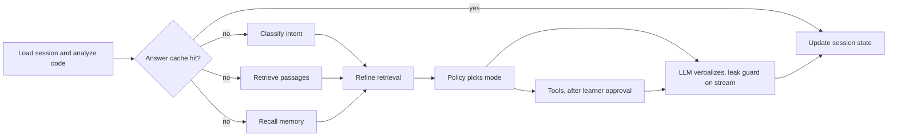

# CodeBuddy

CodeBuddy is a programming tutor for beginners. Instead of handing over answers, it guides a
learner through the PCDIT process (Problem definition, Concrete cases, Design of algorithm,
Implementation, Testing) with Socratic hints grounded in course material. The answer is never
locked away: the learner can always get it, and the tutor offers it when hints are not helping.
It runs as a FastAPI service with a Streamlit front end.

## The problem

Beginners rarely fail on syntax. They fail on the process: they start typing before they
understand the problem, skip concrete examples, and cannot say what their program should do.
General chatbots make this worse by pasting a full solution on request, so nothing is learned.
Pure Socratic tutors fail the other way: a stuck, frustrated learner gets question after
question and gives up.

## The solution

- **PCDIT-guided hints.** The tutor follows the learner's stage and asks one small question at a
  time, escalating through a hint ladder (levels 0 to 3) before it explains or reveals.
- **Grounded in course material.** Replies retrieve from an ingested textbook and cite their
  sources.
- **The answer is always reachable.** Show answer is available after the first hint. The tutor
  offers the answer after 3 hints, a time cap, or frustration signals, and an explicit request
  always reveals.
- **Policy in code, not prompt.** `pedagogy/policy.py` picks the mode; the model only puts it
  into words. A streaming guard blocks corrected code at hint levels 0 to 3, so a prompt slip
  cannot leak the answer.

## What it can do

**Tutoring**
- Hint ladder, error explanations, and PCDIT stage tracking per session
- Frustration detection that moves the answer within reach
- Fix detection from the code, then an optional five-question quiz on the same bug, easy to hard

**Knowledge**
- Hybrid retrieval (dense plus BM25) over Qdrant, with source citations
- Two corpora: `fundamentals` is learner-facing, `pedagogy` (the PCDIT paper) is never
  reachable from learner turns

**Code help**
- Static analysis of learner Python for common bug patterns
- Runtime tracing in a sandbox, only after the learner approves the run
- An MCP tool server for analysis, concrete-case suggestions, and tracing

**Voice**
- Groq Whisper speech-to-text with an editable transcript before sending

**Optional memory**
- Semantic, episodic, and procedural notes about a learner across sessions
- Opt-in per learner, viewable, and erasable with Forget me

**Speed and reliability**
- Streaming replies, layered caches, model tier fallbacks, and a degraded reply when models fail

**Safety and operations**
- Answer-leak guard, API keys, rate limits, CORS, and metrics at `/v1/metrics`
- An offline eval that runs without keys

## How one turn works



The API loads the session, runs static analysis on any code, and checks the answer cache. On a
miss it classifies the message, retrieves course passages, and recalls the learner's memory (when
opted in) in parallel, then refines the retrieval for short follow-ups. The pedagogy policy
chooses a mode (hint at a level, explain, or reveal) from session state, with no model call. Tools
such as code tracing pause the turn until the learner approves. The model then phrases a reply for
that mode, every token passes through the leak guard, and the session state is updated.

## Tech stack

| Concern | Technology |
|---|---|
| API | FastAPI, Server-Sent Events |
| Agent | LangGraph, LangChain |
| LLM and embeddings | OpenAI, three model tiers set in the environment |
| Speech to text | Groq Whisper |
| Vector search | Qdrant (embedded by default), `fastembed` BM25 |
| Cache | Upstash Redis, or in-process memory |
| Learner memory | mem0 |
| Tools | MCP (LangChain `langchain.mcp`) |
| UI | Streamlit |
| Tooling | uv, ruff, pytest |

## Quick start

### A. Try it with no keys

```bash
uv sync --extra ui
uv run uvicorn codebuddy.api.demo:app --port 8000        # terminal 1
uv run streamlit run src/codebuddy/ui/app.py             # terminal 2
```

Open http://localhost:8501, paste buggy Python into **Your code**, and ask a question. The tutor
shows its steps while it works, then streams the reply; references sit collapsed under each
reply. Click **Show answer** after the first hint, and approve the run when the tutor asks to
execute your code. **New chat** in the sidebar starts a fresh problem; earlier chats stay listed
there for this tab. The demo replays
scripted replies over a small sample corpus in `data/sample/`; the policy, leak guard,
approval step, and sandbox are real.

### B. Run with real services

```bash
cp .env.example .env      # then edit .env
```

Fill in `OPENAI_API_KEY` and the three model IDs `CODEBUDDY_MODEL_FAST`,
`CODEBUDDY_MODEL_STANDARD`, and `CODEBUDDY_MODEL_HEAVY` (they have no defaults on purpose).
`UPSTASH_REDIS_REST_URL` and `UPSTASH_REDIS_REST_TOKEN` are optional. Then ingest documents.
PDFs need the `pdf` extra; the empty `CUDA_VISIBLE_DEVICES=` avoids a Docling crash on WSL:

```bash
uv sync --extra ui --extra pdf
CUDA_VISIBLE_DEVICES= uv run python -m codebuddy.rag.ingest data/raw/thinkpython.pdf \
    --corpus fundamentals --title "Think Python (v2.0.17)" --licence "CC BY-NC 3.0 Unported"
```

Start the API and UI. The UI reads the API address from `CODEBUDDY_API_URL` (default
`http://localhost:8000`) and, if the server requires one, the key from `CODEBUDDY_API_KEY`:

```bash
uv run uvicorn codebuddy.api.app:app --port 8000         # terminal 1
uv run streamlit run src/codebuddy/ui/app.py             # terminal 2
```

The author's index holds Think Python (338 `fundamentals` chunks) and the PCDIT paper
(29 `pedagogy` chunks, arXiv:2109.08896). Tests, the eval, and the demo use the sample
documents instead. Full steps: [docs/setup.md](docs/setup.md).

The API starts the MCP tool server itself through `langchain.mcp` when
`CODEBUDDY_MCP_ENABLED=true` (the default), so you do not run it. Running
`uv run python -m codebuddy.mcp_server` by hand only checks that it starts: it prints a note on
stderr and waits for an MCP client. If the API cannot start it, the API log says "calling tools
in-process" and the tools run inside the API instead.

### C. Optional features

- **Voice.** Set `GROQ_API_KEY` and restart the API; a microphone appears in the chat input. See
  [docs/ui.md](docs/ui.md).
- **Memory.** Set `CODEBUDDY_MEMORY_ENABLED=true` and `CODEBUDDY_MEMORY_SECRET`. It calls OpenAI
  and stores personal data, so read [docs/memory.md](docs/memory.md) first.
- **API keys and rate limits.** Set `CODEBUDDY_API_KEYS` and `CODEBUDDY_RATE_LIMIT_PER_MINUTE`.
  See [docs/security.md](docs/security.md).

## Using the API

```bash
curl -N -X POST localhost:8000/v1/turn -H 'Content-Type: application/json' \
  -d '{"session_id": "demo-1", "message": "my sum crashes with an IndexError", "code": "nums = [1, 2, 3]\ntotal = 0\nfor i in range(4):\n    total += nums[i]\nprint(total)"}'
```

The reply streams as Server-Sent Events (`meta`, `token`, `approval`, `done`). Because the code
is runnable, this example pauses with an `approval` event until the learner answers through
`/v1/approve`. Other endpoints:
`/healthz`, `/v1/show-answer`, `/v1/approve`, `/v1/stt`, `/v1/session/{id}`, `/v1/memory/learners`, `/v1/memory`,
`/v1/metrics`. Details: [docs/api.md](docs/api.md).

## Project layout

```text
src/codebuddy/
  agent/      LangGraph tutor graph, nodes, static code analysis
  api/        FastAPI app, keyless demo app, auth and rate limits
  cache/      Cache layers on Upstash Redis or memory
  eval/       Offline evaluation and golden cases
  mcp_server/ MCP tool server
  memory/     Opt-in learner memory (mem0)
  pedagogy/   Policy, hint ladder, leak guard, frustration, judge
  rag/        Ingestion, chunking, hybrid retrieval, rerank
  sandbox/    Local code execution backend
  stt/        Speech-to-text providers
  tools/      Tool planning and the MCP client
  ui/         Streamlit app
tests/        Unit and integration tests (offline)
data/         raw/ (your documents), sample/ (offline corpus), index/ (Qdrant)
docs/         Documentation and decision records
```

## Development

```bash
uv run pytest -q                       # all tests, offline
uv run ruff check . && uv run ruff format --check .
uv run python -m codebuddy.eval.run    # offline eval, must print PASS
```

See [docs/testing.md](docs/testing.md).

## Status and limits

The code is covered by offline tests and a keyless eval. Not yet exercised against live
services: OpenAI chat replies, Groq Whisper, Upstash Redis, mem0 extraction, the Docker files,
and PDF parsing beyond the two documents above. The sandbox is not a security boundary; do not
expose it to untrusted users. There are no user accounts (memory uses signed learner tokens),
and instructor features and Langfuse tracing are not built.

## Documentation

- [docs/README.md](docs/README.md): index and status
- [docs/setup.md](docs/setup.md), [docs/configuration.md](docs/configuration.md)
- [docs/architecture.md](docs/architecture.md), [docs/pedagogy-policy.md](docs/pedagogy-policy.md)
- [docs/api.md](docs/api.md), [docs/tools-and-approvals.md](docs/tools-and-approvals.md)
- [docs/memory.md](docs/memory.md), [docs/security.md](docs/security.md)
- [docs/rag-and-ingestion.md](docs/rag-and-ingestion.md), [docs/deployment.md](docs/deployment.md)
- [PROJECT_SPEC.md](PROJECT_SPEC.md): the target design

## Licences and permissions

This repository has no LICENSE file yet, so no licence is granted for the code. Think Python is
CC BY-NC 3.0 Unported (non-commercial). The PCDIT paper needs the authors' permission before
any learner-facing use. See [docs/corpus-manifest.md](docs/corpus-manifest.md).
