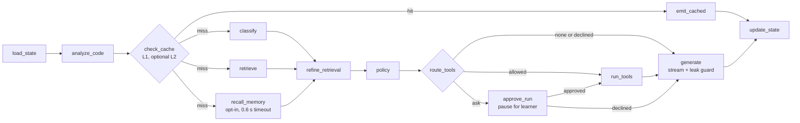
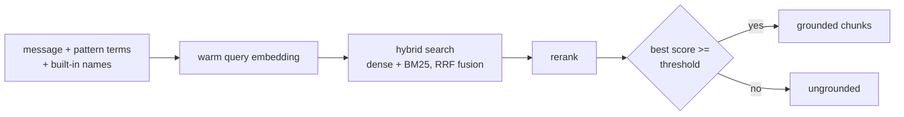

# Architecture and code guide

This describes the code as built. The target design is in [../PROJECT_SPEC.md](../PROJECT_SPEC.md).

## Module map

```
src/codebuddy/
  config.py            Settings (env + .env); model IDs have no defaults
  schemas.py           Enums and models: PcditStage, Intent, HintLevel, Mode, Decision, SessionProgress, API requests
  llm.py               OpenAI tiers via LangChain (fast, standard, heavy) with fallbacks; embeddings
  metrics.py           Cache-backed counters served at /v1/metrics
  pedagogy/
    policy.py          decide_mode(): pure function, picks hint level / explain / reveal / redirect /
                       confirm; fixed_it(): fix detection from the code alone
    frustration.py     show-answer request, frustration signals, quiz skip and stop phrases
    quiz.py            Five-question quiz bank per bug pattern (easy to hard) and its grading; no model
    templates.py       system and user prompts per mode; PCDIT question banks; fallback text
    guard.py           StreamGuard: blocks corrected code in the token stream at hint levels 0-3
    judge.py           Sampled LLM check for leaks written in prose (runs after the reply)
  agent/
    code_analysis.py   AST analysis of learner Python; five bug patterns; never executes code
    state.py           TutorState (graph state) and Classification (classifier output)
    deps.py            Deps container (including the optional memory); LLMClassifier and offline HeuristicClassifier
    nodes.py           The graph nodes (TutorNodes), including tool planning and approval
    graph.py           Wires nodes into a LangGraph StateGraph with a checkpointer; run_turn()
  tools/
    functions.py       analyze_python, suggest_cases, trace_python
    policy.py          Risk classes and the ask / allow / deny rule
    runner.py          LocalToolRunner (in-process) and MCPToolRunner (stdio MCP session)
  mcp_server/          MCPServer exposing the tools (python -m codebuddy.mcp_server)
  sandbox/             check.py (allowlist), harness.py (child program), runner.py (subprocess),
                       backend.py (SandboxBackend seam; `local` is the only backend)
  memory/
    types.py           MemoryKind (semantic, episodic, procedural), MemoryItem, Episode
    store.py           LearnerMemory protocol and InMemoryLearnerMemory (tests, demo)
    mem0_store.py      Mem0LearnerMemory: mem0 over embedded Qdrant (see memory.md)
  stt/
    transcribe.py      Groq Whisper and OpenAI transcribers behind SpeechToText
    normalize.py       Spoken symbols to code ("i plus plus" to "i++"); vocabulary prompt
  cache/
    base.py            Cache protocol (get, set with TTL, set_nx, delete, incr)
    memory.py          InMemoryCache (tests, no-Upstash fallback)
    upstash.py         UpstashCache over upstash_redis.asyncio
    keys.py            Key builders; all version and context ingredients live here
    layers.py          AnswerCache (L1), CachedEmbeddings (L3), RetrievalCache (L4), SessionStore (L6)
    semantic.py        SemanticIndex (optional L2)
  rag/
    chunking.py        Markdown to chunks; code blocks never split
    ingest.py          load, chunk, embed, idempotent upsert; CLI
    store.py           Qdrant client, per-corpus collections, hybrid vector store, filters
    retrieve.py        Retriever: filter, hybrid search, rerank, threshold, corpus access control
    rerank.py          Reranker protocol; NoopReranker; CrossEncoderReranker (optional)
    manifest.py        What was ingested, SHA-256, licence
    fakes.py           HashSparse and ScriptedChat for tests, evals, and demo
  api/
    app.py             FastAPI app: SSE streaming, approvals, quiz start, speech, memory endpoints, metrics, TTFT logging
    security.py        API keys, rate limiting, pending-approval ownership, LearnerTokens
    wiring.py          Builds production resources (cache, models, MCP, checkpointer, STT, judge, memory); loads .env
    demo.py            Keyless demo app (scripted tutor, real sandbox, canned transcript)
  ui/
    client.py          httpx SSE client (no Streamlit import)
    app.py             Streamlit page
  eval/
    run.py             Offline evals with thresholds; golden/*.jsonl data
```

## One turn, end to end



| Node | What it does | File |
|---|---|---|
| `load_state` | Loads `SessionProgress` from the session cache, trims input, counts identical resubmissions, binds the session to the verified learner (or, if the session belongs to another learner, drops the learner id and keeps the turn out of that learner's history) | `agent/nodes.py` |
| `analyze_code` | Parses Python with `ast`, records bug patterns and syntax errors | `agent/code_analysis.py` |
| `check_cache` | L1 exact lookup when no code is attached; optional L2 semantic lookup; on a miss takes a single-flight lock so duplicate concurrent questions generate once. Skipped entirely for a learner with memory active | `agent/nodes.py` |
| `emit_cached` | Streams the cached answer; skips every model call | `agent/nodes.py` |
| `classify` | Fast-tier structured output: intent, PCDIT stage, concepts, search query. Sees the last two history entries (200 characters each, delimited as data) to resolve "it" and "that"; none on foreign turns. Rule-first for "show me the answer"; heuristic fallback on error. A new problem resets the hint ladder | `agent/deps.py` |
| `retrieve` | Hybrid search over the `fundamentals` corpus with `build_query()`: the message plus concepts and search terms of detected bug patterns and names of built-ins the code calls, never the code itself. Runs in parallel with `classify` | `rag/retrieve.py`, `rag/query.py` |
| `recall_memory` | Only when memory is on and the turn has a verified learner token: searches that learner's notes with the message, under a timeout (`MEMORY_RECALL_TIMEOUT_S`). Errors and timeouts give no notes. Runs in parallel with `classify` and `retrieve` | `agent/nodes.py` |
| `refine_retrieval` | Retrieves again with the classifier's standalone `search_query` and concepts when that query differs from the first, then merges both lists by reciprocal rank fusion. Skipped for foreign turns. See [rag-and-ingestion.md](rag-and-ingestion.md#query-building-and-fusion) | `agent/nodes.py`, `rag/query.py` |
| `policy` | While a quiz runs, grades the answer first (`quiz.advance()`): a reply written by code, or one level-0 hint. Otherwise `fixed_it()` sets the fixed signal and `decide_mode()` runs with intent, progress, signals, and the clock. Also plans which tools to use (none during a quiz) | `pedagogy/policy.py`, `pedagogy/quiz.py` |
| `route_tools` | Maps the learner's stored permission to run, ask, or skip | `tools/policy.py` |
| `approve_run` | Pauses with `interrupt()` until the learner approves or declines running their code | `agent/nodes.py` |
| `run_tools` | Calls the planned tools through the tool runner (MCP or in-process) with a timeout | `agent/nodes.py` |
| `generate` | Streams a quiz reply written by code without a model call. Otherwise builds prompts (including private notes from analysis, runtime facts, case ideas, and recalled memory in a `<memory>` block), streams the chosen tier through `StreamGuard`, handles guard stops and model outages | `agent/nodes.py` |
| `update_state` | Advances the ladder (a reveal or a confirmed fix resets it; quiz turns leave it alone), remembers the bug patterns of the code sent, appends history, saves progress, starts a background memory write on a reveal or every Nth hint, stores cacheable answers (and the semantic index entry), releases the lock, counts the turn | `agent/nodes.py` |

`classify`, `retrieve`, and `recall_memory` run in parallel and join before `refine_retrieval`, so
the first retrieval does not wait for the classifier, and memory adds no time unless it hits its
timeout. The second, fused retrieval does wait for the classifier, so it adds one search to most
live turns (cached by L3 and L4; not measured live). Without memory `recall_memory` returns at once.

### Streaming events

Nodes emit custom events through LangGraph's stream writer. `run_turn()` yields them and then
one `final` event with the end state:

| Event | Payload | Emitted by |
|---|---|---|
| `meta` | mode, hint level, stage, `can_show_answer`, `offer_answer`, `offer_quiz`, `quiz_concept`, `quiz`, `quiz_code`, `cached` | `generate`, `emit_cached` (before the first token) |
| `step` | `key`, `label`, `status` (`running`, `done`), `detail`; fixed learner-safe text from `agent/steps.py` | `analyze_code`, `check_cache`, `classify`, `retrieve`, `recall_memory`, `policy`, `run_tools`, `generate` |
| `token` | `text` already approved by the leak guard | `generate`, `emit_cached` |
| `final` | the complete graph state (not sent to clients as-is) | `run_turn` |

`api/app.py` turns these into SSE events and adds timings (see [api.md](api.md)). A paused turn is
detected after the stream ends (`run_turn` reads the checkpoint) and becomes an `approval` event;
see [tools-and-approvals.md](tools-and-approvals.md). `POST /v1/quiz` does not run the graph: it
starts the quiz in the session and streams question 1 itself, in the same event shape.

## The decision layer

`pedagogy/policy.py` decides what happens; the model only words it. Details and the exact rules
are in [pedagogy-policy.md](pedagogy-policy.md). Two properties matter for the code:

1. `decide_mode()` is pure (no I/O, injected clock), so every rule has a unit test.
2. The model never picks the hint level. `templates.system_prompt()` embeds the chosen level as
   an instruction, and `StreamGuard` enforces "no corrected code" independently of the model.

## Leak guard

`StreamGuard` (`pedagogy/guard.py`) sits between the model's token stream and the client.

- Prose is released as soon as the first word of a line shows it cannot be a code statement, so
  it adds about one token of delay rather than buffering a whole line.
- Lines that start like code (`for ...:`, `return x`, `import m`, `x = 1`) or open a fenced code
  block are held. A confirmed code line or a non-pseudo-code fence raises `LeakDetected`.
- On `LeakDetected`, `generate` keeps what was already shown and appends a safe question from
  `fallback_text()` for the current PCDIT stage. The state records `guarded=True`.
- It is off for explanations and reveals, where code is allowed. At hint level 3 it allows
  fenced pseudo-code (`text`, `pseudo`, or no language) but not Python.

The spec also describes an LLM judge on every reply. That would delay the first token, so here the
rule check is the only blocking guard and the LLM judge belongs to evals and sampled monitoring
(see [adr/0002-streaming-leak-guard.md](adr/0002-streaming-leak-guard.md)). The judge is not
implemented yet.

## Caching

| Layer | Class | Stores | Key ingredients | Status |
|---|---|---|---|---|
| L1 answers | `AnswerCache` | Concept explanations and redirects with no code attached | normalized message, mode, hint level, index, prompt, and model versions | built |
| L2 semantic | `SemanticIndex` | Pointer to an L1 answer for a similar question | query embedding, threshold, index, prompt, and model versions | built, off by default |
| L3 embeddings | `CachedEmbeddings` | Query vectors (Redis plus a small in-process map) | text, embedding model | built, query path only |
| L4 retrieval | `RetrievalCache` | Reranked chunks | normalized query, corpus, filters, index version | built |
| L5 tool results | none | | | not built (no tools yet) |
| L6 session | `SessionStore` | `SessionProgress` and last 6 history entries | session ID | built |

What is deliberately never cached: hints (they depend on the learner's code and progress) and
reveals (they depend on the learner's code). `is_answer_cacheable()` in `cache/layers.py` encodes
this, and an answer is stored only if retrieval was grounded and the reply was neither guarded
nor degraded. Two more rules keep personalized text out of shared caches: a learner with memory
active skips L1 and L2 completely, and a reply is stored only when the prompt included no session
history (the key ignores history, so storing a follow-up answer would hand it to other learners).

`CachedEmbeddings` exists because LangChain vector stores call the synchronous embedding methods
while the cache is asynchronous. `warm_query()` loads or computes the vector into a small
in-process map first, then `embed_query()` reads it. Ingestion embeds documents directly and does
not use the cache.

## Retrieval



- One Qdrant collection per corpus: `cb_<corpus>_<index_version>`.
- `Retriever(allowed=...)` rejects corpora it was not built for. The production retriever allows
  only `fundamentals`, so the `pedagogy` corpus cannot reach a learner turn.
- Qdrant's embedded mode is synchronous, so the search runs in `asyncio.to_thread`.
- The hybrid score is a fused rank score, not a similarity. The threshold is only meaningful with
  a real reranker. See [configuration.md](configuration.md).

## Failure handling

| Failure | Behavior |
|---|---|
| Classifier call fails | `heuristic_classification()`: code present means debug help, otherwise concept question |
| Retrieval raises | Empty, ungrounded result; the prompt tells the model no context was found |
| Heavy or standard model fails | `.with_fallbacks()` retries the next lighter tier |
| Every generation tier fails | Degraded reply: apology plus the top course-material snippet; `degraded=True`; the learner's turn still counts as a hint |
| Leak guard fires | Safe stage question appended; `guarded=True` |
| Upstash not configured | In-process cache with a warning |
| Graph raises | API sends an `error` SSE event |
| MCP server fails to start | Tools run in-process; warning logged |
| Tool call fails or times out | Skipped; the reply is generated without runtime facts |
| Learner declines to run code | Reply is generated without a run; choice remembered if asked |
| Speech provider fails | Next provider is tried; if all fail `/v1/stt` returns 502 and the UI says to type |
| Judge fails | Ignored; it runs after the reply and never blocks |
| Memory recall times out or fails | The turn continues without notes; `memory_failures` is counted |
| Memory write fails | Logged and counted; the learner never sees it |
| Memory store cannot start | API starts without memory; `/healthz` shows `memory_enabled: false` |

## State and persistence

- **Learner progress** lives in `SessionProgress` (hints given, start time, stage, reveals, run
  permission, repeated submissions, short history), saved to the session cache after every turn
  with a 2 hour TTL.
- **Turn state** lives in the graph checkpoint. Each turn runs on its own checkpoint thread (the
  `turn_id`), so a turn paused for approval can be resumed later and nothing leaks between turns.
  Production uses `AsyncSqliteSaver` on `CODEBUDDY_CHECKPOINT_PATH`; tests use `InMemorySaver`.
  Types stored in checkpoints are registered in `CHECKPOINT_TYPES` (`agent/graph.py`).
- **Learner memory** is separate from both: mem0 over embedded Qdrant under `CODEBUDDY_MEMORY_PATH`,
  opt-in, keyed by a signed learner token. It lasts until the learner deletes it. See
  [memory.md](memory.md).
- The spec names Postgres for checkpoints. SQLite avoids another service; swap the saver in
  `api/wiring.py` if you need shared checkpoints across several API hosts.

## Not built yet (spec sections)

Instructor features: corpus approval queue, learner reports (12.4 surface 3). Per-user accounts.
Langfuse tracing (17.4). Synthetic-question generation at ingestion (9.2). A hard sandbox
boundary and deployment automation (17, see [security.md](security.md) and
[deployment.md](deployment.md)). The L5 tool-result cache (10.3): tool runs depend on the learner's
code and are not cached. Concept-mastery scores and solved tracking across sessions for the learner model (8.6);
memory keeps only private notes (see [memory.md](memory.md)).
