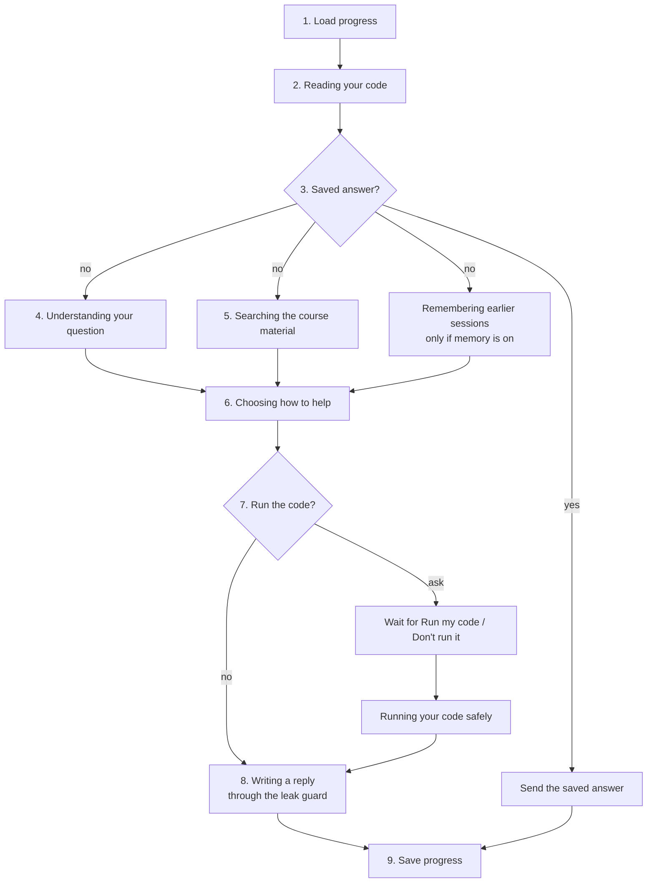

# How the tutor works

This page follows one learner through a few turns, step by step. By the end you will know
what happens between pressing Enter and seeing the reply, and why.

The exact rules live in code: `src/codebuddy/pedagogy/` and `src/codebuddy/agent/nodes.py`.
The reference pages are [../pedagogy-policy.md](../pedagogy-policy.md) and
[../architecture.md](../architecture.md). The numbers on this page were checked against
that code.

## The example

Sam is learning Python. Sam wants to add up a list of numbers and writes this:

```python
nums = [1, 2, 3]
total = 0
for i in range(len(nums) + 1):
    total += nums[i]
print(total)
```

Sam runs it and gets an `IndexError`. Sam pastes the code into the **Your code** box and
types: "my sum crashes with an IndexError".

The bug: the list has 3 items, at positions 0, 1 and 2. `range(len(nums) + 1)` counts 0, 1,
2 and 3. Position 3 does not exist, so Python stops with an `IndexError`. This mistake is
called an **off-by-one error**.

## One turn, step by step

A **turn** is one learner message and one tutor reply. While a turn runs, the UI shows a
small status box with the step names below (the names come from `src/codebuddy/agent/steps.py`).
These steps together are the **tutor graph**: a fixed map of steps, written with
[LangGraph](06-glossary.md#langgraph), where each box is called a **node**.



Steps 4 and 5 (and memory) run **at the same time**, so the turn does not wait for one to
finish before starting the next.

### Step 1: load progress

The API looks up Sam's **session**. A session is everything the tutor remembers about this
one chat: how many hints Sam has had, which step of problem solving Sam is on, and the last
few messages. It is stored in the session cache (see [caches](#caches)) and kept for
**2 hours** after the last turn (`TTL_SESSION`, 7200 seconds).

This is Sam's first turn, so the session is empty: 0 hints so far.

The tutor also notices if Sam sends the exact same code again and again. That counts toward
frustration (see [when the answer is reachable](#when-the-answer-is-reachable)).

### Step 2: reading your code

The tutor reads Sam's code **without running it**. It uses Python's own parser (the `ast`
module) to look for five common beginner bugs. This is called **static analysis**.

| Bug pattern | Concept | Example |
|---|---|---|
| `off_by_one_range` | loop bounds | `for i in range(len(nums) + 1)` |
| `uninitialized_accumulator` | variable initialization | `total += n` before `total` exists |
| `mutating_while_iterating` | iteration and mutation | removing items from a list while looping over it |
| `missing_base_case` | recursion | a function that calls itself with no `if` to stop |
| `shadowed_builtin` | names and scope | `list = [1, 2]` hides the built-in `list` |

It finds `off_by_one_range` on Sam's code. This finding is **private**: it helps the tutor
ask a good question, but it is never shown to Sam directly.

### Step 3: is there a saved answer?

Before doing any expensive work, the tutor checks the **answer cache**. A cache is a store
of results that were already worked out, so they can be reused.

Only general concept questions with **no code attached** are ever saved, for example "what
is a for loop?". Sam attached code, so the cache is skipped. Hints are never saved, because
they depend on the learner's own code and progress.

### Step 4: understanding your question

A small, fast AI model reads Sam's message and labels it. This is called **classifying**.
It returns:

- the **intent**: what Sam wants. One of `debug_help` (fix my code), `concept_question`
  (explain an idea), `problem_start` (I am starting a new problem), `show_answer`, or
  `off_topic`.
- the **PCDIT stage**: which step of problem solving Sam is on (see
  [PCDIT](06-glossary.md#pcdit)).
- a short **search query** for the next step.

Sam's message is `debug_help`. If the model call fails, simple rules take over: code
attached means `debug_help`, no code means `concept_question`.

Some phrases skip the model entirely. "Show me the answer", "give me the solution", "just
tell me" and "reveal the solution" are matched by a rule (`asks_for_answer()` in
`src/codebuddy/pedagogy/frustration.py`).

### Step 5: searching the course material

At the same time, the tutor searches the knowledge base: the book Think Python, cut into
pieces of 800 to 2000 characters called **chunks**. This is the "retrieval" in
[RAG](06-glossary.md#rag).

The search uses two methods at once, called [hybrid search](06-glossary.md#hybrid-search):

- **Meaning search** ([embeddings](06-glossary.md#embedding)): finds chunks about the same
  idea even if they use different words.
- **Word search** ([BM25](06-glossary.md#bm25)): finds chunks that share exact words, such
  as `range` or `IndexError`.

The search text is Sam's message plus words for the bug pattern ("loop bounds"), never
Sam's code. The best 5 chunks (`RERANK_TOP`) go to the reply step. When the classifier's
search query is different from the first one, the tutor searches a second time and merges
the two lists.

Only the `fundamentals` collection (Think Python) can be searched from a learner turn. The
`pedagogy` collection (the PCDIT paper, which is guidance for the tutor, not for learners)
is kept in a separate collection the learner side cannot open.

### Step 6: choosing how to help (the policy)

This is the heart of CodeBuddy. The **policy** is a plain Python function,
`decide_mode()` in `src/codebuddy/pedagogy/policy.py`. It makes no AI call. It looks at the
intent, Sam's progress and a clock, and picks a **mode**:

| Mode | When | What the reply does |
|---|---|---|
| `hint` | `debug_help` or `problem_start` | One step on the hint ladder (below) |
| `explain` | `concept_question` | A direct, short explanation |
| `reveal` | Sam asked for the answer, or pressed Show answer | The full fixed code and why |
| `redirect` | `off_topic` | Two polite sentences back to programming |
| `confirm` | Sam's new code fixed the bug | Says what the change fixed and offers a quiz |

Sam has had 0 hints, so the policy picks `hint` at **level 0**.

### Step 7 (optional): may I run your code?

Sometimes seeing the code run helps the tutor ask a better question. In hint mode, when the
code has no syntax error, the tutor plans to run it with a **tool** called `trace_python`.
A tool is a small helper program the tutor can call. Rules in code choose the tool, never
the AI model.

Running code is risky, so the tutor **asks first**. The turn pauses and the UI shows Sam's
code with two buttons, **Run my code** and **Don't run it**, plus a box "remember my
choice for this chat". Nothing is written and nothing runs until Sam chooses.

While it waits, the paused turn is saved in a small database file (a
[checkpoint](06-glossary.md#checkpoint), `data/checkpoints.sqlite` by default). A paused
turn can be answered for **15 minutes**; after that the UI says "That request expired.
Send your message again."

If Sam says yes, the code runs in a [sandbox](06-glossary.md#sandbox): a separate Python
process with a 3 second time limit, a 256 MB memory limit, and only the `math`, `random`
and `string` modules allowed. The tutor learns what happened ("IndexError at line 4, i was
3"). Like the bug pattern, this stays private.

> **Warning:** the sandbox is a safety net for beginners' exercises, not a security
> boundary. A determined attacker could break out. Do not expose it to strangers on the
> internet without a container around it. See [../security.md](../security.md).

### Step 8: writing a reply, through the leak guard

Now an AI model writes the reply. The prompt tells it the mode, the hint level, the word
limit, the 5 book chunks, the private notes (bug pattern, run result), and the last few
messages. The model's job is only to put the decision into friendly words.

The reply is **streamed**: it appears word by word as the model writes it, instead of all
at once at the end. The tool for this is [SSE](06-glossary.md#sse).

Every piece of the stream passes through the **leak guard**
([StreamGuard](06-glossary.md#streamguard), `src/codebuddy/pedagogy/guard.py`) before Sam
sees it. At hint levels 0 to 3 it stops any line that looks like corrected code: a
`for ...:` line, an assignment such as `total = 0`, a `return` line, or a fenced Python code
block. If it fires, what Sam already saw stays,
and a safe question for Sam's current stage is added instead.

The guard is off for explanations and reveals, where code is allowed. It cannot catch a
fix written in plain words ("remove the plus one"). The prompt asks the model not to do
that, but only the code-shaped leaks are blocked for sure.

Sam might see:

> The crash happens on the last pass of your loop, at `total += nums[i]`. There `i` is one
> past the end, so it asks for an item your list does not have. What is the biggest `i`
> your loop line lets through?

### Step 9: save progress

Finally the tutor updates Sam's session:

- the hint count goes from 0 to 1, and the problem's start time is noted,
- the PCDIT stage is updated,
- Sam's message and the reply are added to the short history,
- the bug patterns of this code are remembered, so the next turn can tell whether Sam fixed
  them.

## The hint ladder

The ladder has five rungs. Each new hint on the same problem climbs one rung, but the tutor
never climbs past level 3 on its own. Level 4 only comes when Sam asks.

| Level | Name in code | What the tutor does | Word limit |
|---|---|---|---|
| 0 | `DIAGNOSE` | Says where the problem is and what causes it, in plain words, then asks one question toward the fix | 60 |
| 1 | `LOCATE` | Narrows down to the exact step or value that goes wrong and why, with a nudge on what to change, as an idea | 60 |
| 2 | `NAME_CONCEPT` | Names the concept (for example "off-by-one"), shows a tiny trace of values, asks one check question | 90 |
| 3 | `SCAFFOLD` | A plan in pseudo-code, or a worked example on a *different* problem | 110 plus the pseudo-code |
| 4 | `REVEAL` | The full fixed code, why it failed (up to 120 words), and a question on a slightly different case | 120 for the "why", plus the code |

Every hint ends with exactly one question. [Pseudo-code](06-glossary.md#pseudo-code) is a
plan written in plain words laid out like code, so it shows the steps without being Python.

Word limits are requests to the model. As a backstop, the code also caps how much the model
may write per mode: 250 tokens for a hint, 320 for an explanation, 1500 for a reveal and 90
for a redirect (settings `CODEBUDDY_MAX_TOKENS_*`). A [token](06-glossary.md#token) is a
piece of a word, roughly 4 characters of English.

So if Sam keeps asking for help with the same bug, the hints go: level 0, 1, 2, 3, 3, 3...

## When the answer is reachable

Two different things happen: the **Show answer** button turns on, and the tutor **offers**
the answer.

### Show answer turns on

The **Show answer** button under the latest reply becomes usable:

- **after the 4th hint** on this problem (`SHOW_AFTER_HINTS = 4` in
  `src/codebuddy/pedagogy/policy.py`), so from the 5th tutor reply on, or
- **sooner**, as soon as one of the offer triggers below fires (frustration or the time cap).

### The tutor offers the answer

The tutor *offers* the answer when any of these is true. An offer does not reveal anything.
The hint is still given, the reply ends by saying Show answer is available, and the button
is highlighted. Sam decides.

| Trigger | Exact rule |
|---|---|
| Hints without progress | 5 hints given on this problem, so from the 6th hint on |
| Turn cap | `LADDER_MAX_TURNS` hints given (default 6; with the defaults the 5-hint rule fires first) |
| Time cap | 600 seconds (10 minutes) since the first hint on this problem (`LADDER_MAX_SECONDS`) |
| Give-up phrase | "I give up", "this is stupid", "I'm stuck", "I'm frustrated", "I'm lost", "I don't get it", "this makes no sense", and close variants |
| Same code again | The same code sent a third time in a row |

### Asking always works

Typing a request such as "show me the answer" or "just tell me", or pressing Show answer
when it is on, **always** reveals. This works even on the very first turn. The tutor
guides, but it never holds the answer hostage.

After a reveal the ladder starts again from level 0 for the next problem.

## When Sam fixes the bug

Say Sam changes the loop to `for i in range(len(nums)):` and sends it. The tutor decides
from the **code alone** whether it is a fix (`fixed_it()` in
`src/codebuddy/pedagogy/policy.py`). All of these must be true:

1. The code Sam sent last time had a bug pattern.
2. This code is different.
3. This code has no syntax error.
4. None of the old bug patterns are left.
5. It is still the same program: every function name is still there, and at least 60% of
   the statements are kept. Deleting everything is not a fix.

Saying "I fixed it" with the same code is not enough. When it is a fix, the mode is
`confirm`: a short reply (at most 60 words) says what the change fixed, asks Sam to explain
in one sentence why it works, and offers a quiz. The hint count goes back to 0.

Known gap: if the fix only moves the bug somewhere the static analysis cannot see, it is
still counted as a fix.

## The quiz

Under the reply a **Try a quiz** button appears. It stays until Sam starts the quiz, starts
a new problem, or sends new buggy code.

The quiz has **5 questions on the same kind of bug**: 2 easy, 2 medium and 1 hard. Easy is
a short, obvious version; medium hides the bug in a slightly longer function; hard puts it
in a nested loop or a helper function. The questions are written by hand in
`src/codebuddy/pedagogy/quiz.py`, not by an AI model, and the answers are graded by code.

How a question works:

1. The buggy snippet appears in the **Your code** box. Sam fixes it there and sends it.
2. If the bug pattern is gone, the reply says "Correct." and shows the next question.
3. On the first wrong try, Sam gets one level-0 hint (the leak guard is on).
4. On the second wrong try, or on **Skip question**, the stored solution is shown and the
   next question follows.
5. Sending the snippet unchanged, or completely different code, is not graded and does not
   use up a try.
6. **Stop quiz** ends it early. At the end Sam sees a score such as "4 of 5".

Inside a quiz there is no hint ladder, no tools, no caching and no memory writes, and Show
answer is hidden.

## Conversation memory: the short window

The model does not remember anything by itself between calls. The tutor sends it a short
**history** with each prompt:

- the last **6 messages** (Sam's and the tutor's, so about 3 back-and-forths),
- each cut to **500 characters**,
- kept with the session for **2 hours** after the last turn.

The classifier sees even less: the last 2 history entries, 200 characters each. That is
enough to understand "it" and "that" in a follow-up question.

Without Upstash (see [caches](#caches)) the session lives inside the API process, so
restarting the API forgets every session.

## Long-term memory: optional and opt-in

Long-term memory keeps short private notes about a learner **across** sessions, for
example "confuses `=` with `==`". It is built on a library called mem0 and is **off by
default** (`CODEBUDDY_MEMORY_ENABLED=false`).

When the server has it on, each learner still has to opt in:

1. Open **Settings** at the bottom of the sidebar.
2. Tick **Remember me across sessions**. It is unticked on every fresh page.
3. **Show what I remember** lists every note.
4. **Forget me** deletes every note, turns memory off and starts a new chat.

Rules that never bend:

- The policy **never** reads memory. Notes cannot change the hint level or when the answer
  is offered. They only help the model pick a better question.
- Notes are put into the prompt as private data, never shown to the learner as is.
- A learner with memory on skips the answer caches, so personal replies are never shared.
- Notes are written after a reveal and on every 4th hint (`MEMORY_WRITE_EVERY`), in the
  background. Reading them gives up after 0.6 seconds so a turn is never slowed much.

Memory calls OpenAI and stores personal data on the server. Read [../memory.md](../memory.md)
before turning it on.

## Caches

CodeBuddy has several cache layers, numbered L1 to L6 after the design document. Each
remembers a different kind of result:

| Layer | What it remembers | Kept for (default) |
|---|---|---|
| L1 answers | Replies to concept questions and redirects with no code attached | 1 day |
| L2 semantic | A pointer from a *similar* question to an L1 answer. Off by default | 1 day |
| L3 embeddings | The number lists ([embeddings](06-glossary.md#embedding)) of search queries | 30 days |
| L4 retrieval | Search results for a query | 3 hours |
| L5 tool results | Not built: tool runs depend on the learner's code | |
| L6 session | Each session's progress and short history | 2 hours |

The caches live in [Upstash Redis](06-glossary.md#redis-and-upstash) (a hosted database)
when you set its keys, otherwise in the API's own memory.

Never cached: hints and reveals. Cache keys include the hint level, the mode, the index
version, the prompt version and the model versions, so a changed prompt or a new book never
serves an old answer. After editing a prompt, the version `CODEBUDDY_PROMPT_VERSION`
(currently `p6`) is bumped for that reason.

## Models, tiers and fallbacks

CodeBuddy uses OpenAI models only, in three **tiers**. You choose the model for each tier in
`.env`; there are no built-in defaults.

| Tier | Setting | Used for | Time limit |
|---|---|---|---|
| fast | `CODEBUDDY_MODEL_FAST` | Classifying the question, off-topic redirects, memory notes | 3 s |
| standard | `CODEBUDDY_MODEL_STANDARD` | Hints, explanations, fix confirmations | 5 s |
| heavy | `CODEBUDDY_MODEL_HEAVY` | Full-answer reveals | 30 s |

If a model call fails or comes back empty, the tutor **falls back** to the next lighter
tier: heavy, then standard, then fast. Before falling back, the mode's own tier gets one
retry with a bigger cap (4 times the cap, at most 4000 tokens), because a "reasoning" model
can spend its whole budget thinking and return nothing.

## What "degraded" means

If **every** tier fails (for example a wrong key, no internet, or OpenAI is down), the
tutor does not crash. It sends a short **degraded** reply written by code:

- a hint or a confirmation gets a standard question for the learner's current stage,
- an explanation gets two sentences from the best book chunk (or "try again"),
- a reveal says "Press Show answer again in a moment",
- an off-topic message gets the usual redirect.

A degraded turn counts for nothing: no hint step, no ladder reset, no history, no memory
write and nothing cached. The UI shows a warning when an explanation or a reveal was
degraded. The log line says which tier failed and why.

## Why pedagogy is code, not prompt

You could write "give small hints first, never show the answer early" in a prompt and hope
the model obeys. CodeBuddy does not do that, for three reasons:

1. **Models do not always obey.** A prompt is a request. Code is a rule.
2. **Code can be tested.** `decide_mode()` is a pure function with no network calls, so
   every rule has an automatic test, and the offline evaluation checks the escalation
   rules on every change.
3. **The answer must stay reachable.** A model that is "too Socratic" frustrates learners
   until they quit. Code guarantees Show answer turns on after 4 hints and that an explicit
   request always reveals.

So the split is: the policy decides, the model words it, and the leak guard checks the
words. That is the most important idea in this project.

Next: [02-run-it-on-your-computer.md](02-run-it-on-your-computer.md).
