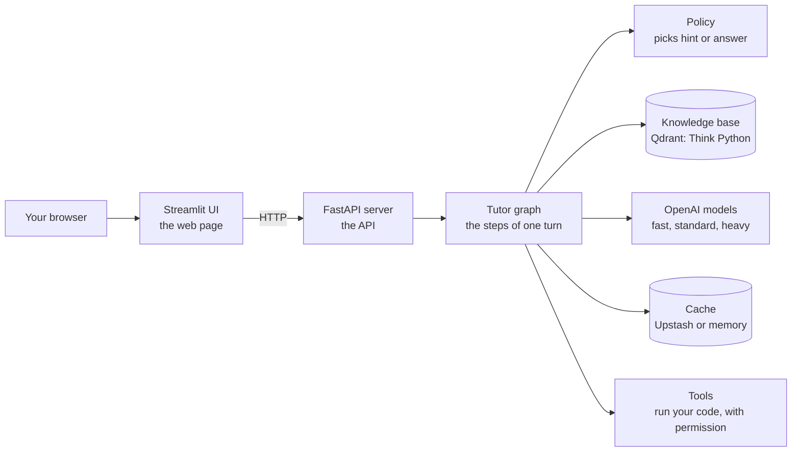

# Start here: the CodeBuddy beginner guide

This guide explains CodeBuddy from the ground up. It assumes you are new to AI apps, to
RAG, to servers, and to Python projects. Every technical word is explained the first time
it appears, and the [glossary](06-glossary.md) collects them all.

The other pages in `docs/` are the reference manual. They are exact and complete, but they
assume you already know the words. Read this guide first, then use the reference pages when
you need a detail.

## What CodeBuddy is

CodeBuddy is a programming tutor for people learning Python.

A learner pastes some code that does not work and asks a question. CodeBuddy does not just
hand back the fixed code. It asks one small question at a time that points the learner
toward the bug, so the learner finds the fix and learns why it was wrong. This style of
teaching by questions is called [Socratic](06-glossary.md#socratic) teaching.

The answer is never locked away. After a few hints the learner can press **Show answer**,
and typing "show me the answer" works at any time. CodeBuddy only refuses to *leak* the
answer by accident while it is still giving hints.

## Who it helps

- **Beginners** who get stuck on their first loops, lists and functions.
- **Teachers** who want a tutor that guides rather than does the homework.
- **You, the developer**, if you want to learn how a real AI app is built: it has a web
  page, a server, a search engine over a textbook, AI models, caches, logs and tests.

## The 5-minute picture

Read it left to right:

1. **Your browser** shows a web page.
2. The web page is built with [Streamlit](06-glossary.md#streamlit), a Python library for
   making web pages. We call it the **UI** (user interface).
3. The UI sends your message to the **API**, a small web server written with
   [FastAPI](06-glossary.md#fastapi). An API is a program that other programs talk to.
4. The API runs the **tutor graph**: a fixed list of steps for one learner turn, built with
   [LangGraph](06-glossary.md#langgraph). One question and one reply is one **turn**.
5. One step is the **policy**. It is plain Python code that decides what kind of help to
   give: a small hint, a bigger hint, an explanation, or the full answer.
6. Another step searches the **knowledge base**, a textbook (Think Python) cut into small
   pieces and stored in [Qdrant](06-glossary.md#qdrant), a search database.
7. A **model** from OpenAI then writes the reply in friendly words. The model never decides
   the kind of help. It only puts the policy's decision into words.
8. **Caches** remember things so the same work is not done twice.
9. **Tools** can run your code in a safe box, but only after you say yes.

Searching a knowledge base and then asking a model to answer from what was found is called
[RAG](06-glossary.md#rag) (retrieval-augmented generation).

## Reading order

| Step | Page | What you will learn |
|---|---|---|
| 1 | [01-how-the-tutor-works.md](01-how-the-tutor-works.md) | One learner turn as a story: every step, the hint ladder, Show answer, the quiz, memory, caches, models |
| 2 | [02-run-it-on-your-computer.md](02-run-it-on-your-computer.md) | Install, try the keyless demo, then run it for real with your own keys and documents |
| 3 | [04-logs-tracing-and-evaluation.md](04-logs-tracing-and-evaluation.md) | Read the logs, send traces to Langfuse, score answers with RAGAS |
| 4 | [05-troubleshooting.md](05-troubleshooting.md) | Fix common problems: symptom, cause, fix |
| 5 | [06-glossary.md](06-glossary.md) | Look up any word |

## I want to...

| I want to... | Read this |
|---|---|
| See it working in 5 minutes, with no keys and no cost | [02, keyless demo](02-run-it-on-your-computer.md#3-try-the-keyless-demo) |
| Understand why it gives hints and not answers | [01, the hint ladder](01-how-the-tutor-works.md#the-hint-ladder) |
| Know when Show answer turns on | [01, when the answer is reachable](01-how-the-tutor-works.md#when-the-answer-is-reachable) |
| Use real AI models | [02, real mode](02-run-it-on-your-computer.md#4-real-mode-the-env-file) |
| Add my own documents | [02, adding documents](02-run-it-on-your-computer.md#6-add-documents-ingestion) |
| Use Qdrant Cloud | [02, where the knowledge base lives](02-run-it-on-your-computer.md#7-where-the-knowledge-base-lives) |
| Find out what happened in one turn | [04, logs](04-logs-tracing-and-evaluation.md#1-logs-what-the-program-wrote-down) |
| Measure answer quality | [04, RAGAS](04-logs-tracing-and-evaluation.md#3-ragas-scoring-answer-quality) |
| Fix an error message | [05-troubleshooting.md](05-troubleshooting.md) |
| Look up every setting | [../configuration.md](../configuration.md) (reference) |
| Read the code map | [../architecture.md](../architecture.md) (reference) |

## What has and has not been tested

Be honest with yourself about this before you rely on it.

- Everything is covered by automatic tests that run **offline**: no internet and no keys.
  Fake models and a small sample textbook stand in for the real ones.
- The keyless demo runs for real on your computer.
- Ingesting the two real PDFs with real OpenAI embeddings was run once by the author.
- **Not tested live:** OpenAI chat replies, Groq voice, Upstash Redis, Langfuse cloud,
  Qdrant Cloud. The code follows each service's documentation, but treat
  your first live run as a test.

The full status list is in [../README.md](../README.md#status).
