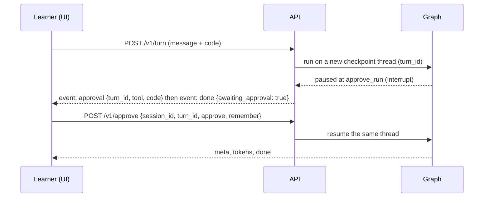

# Tools, sandbox, MCP, and human approval

Code: `src/codebuddy/tools/`, `src/codebuddy/sandbox/`, `src/codebuddy/mcp_server/`, and the
`approve_run` / `run_tools` nodes in `src/codebuddy/agent/nodes.py`.
Design background: [../PROJECT_SPEC.md](../PROJECT_SPEC.md) Sections 12.3 and 12.4.

## What the tutor can do with tools

| Tool | Risk | What it does | When the tutor uses it |
|---|---|---|---|
| `analyze_python` | read | Static bug-pattern analysis | Exposed over MCP. The graph already runs the same analysis in-process, so it is not called twice |
| `suggest_cases` | read | Small concrete inputs to try by hand for each function | When the classifier says the learner is starting a problem (`problem_start`) and sent code |
| `trace_python` | execute | Runs the learner's code in the sandbox; returns output, any error with its line, and a variable trace | When the learner is debugging (`debug_help`, hint mode) and the code parses. **Only with permission** |

The model does not choose tools. `TutorNodes._plan_tools()` decides from the intent, the
decision mode, and whether the code parses. Tool results reach the model only as private notes
("when the code was run: IndexError ... at line 4"). The leak guard still applies to the reply,
so a runtime finding helps the tutor ask a better question without handing over the fix.

## Human in the loop: asking before running code



- `route_tools` maps the learner's stored choice (`SessionProgress.run_permission`) to an action
  with `tools/policy.decide_permission()`: `ask` pauses the graph, `allow` runs, `deny` skips.
- `approve_run` calls LangGraph's `interrupt()`. On resume it records the answer. With
  `remember: true` (the UI default) approving sets the permission to `allow` and declining sets it
  to `deny` for the rest of the session. With `remember: false` the learner is asked again next time.
- Nothing is generated and nothing is run before the decision. A paused turn is held in the
  checkpoint database (SQLite file in production, memory in tests).
- Only the session that owns a paused turn can answer it, and each approval works once
  (`api/security.PendingApprovals`, 15 minute expiry). Others get HTTP 404.
- Reveals and syntax errors never run code.

Not built: the spec's instructor surfaces (approving corpus additions, the review queue, sharing a
learner report with an instructor). The `WRITE_SHARED` risk class exists in `tools/policy.py` and
always resolves to "skip", so a future write tool cannot run by accident.

## The sandbox

`sandbox/runner.run_python(code)` runs beginner Python and reports what happened. Layers:

1. **Static allowlist** (`sandbox/check.py`). Refused before running: imports other than `math`,
   `random`, `string`; `class` definitions and async code; names such as `eval`, `exec`, `open`,
   `input`, `getattr`, `type`, `__import__`; any attribute starting with `_`; `.format` and
   `.format_map` (format strings can reach attributes); code over 4000 characters.
2. **Restricted builtins** inside the child process: a short list of safe functions, and an
   `__import__` that only allows the three modules.
3. **Resource limits**: CPU seconds, address space (default 256 MB), no file writes, recursion
   limit 150, output capped at 4000 characters, wall-clock timeout (default 3 s, then the process is killed).
4. **Clean process**: `python -I -S`, empty environment, throwaway working directory.
5. **No network** when the host allows `unshare -rn` (probed once; `/healthz` reports
   `sandbox_network_isolated`). Otherwise this layer is skipped.

The trace records variable values at the first 20 and last 20 line events of the learner's code.

**This is defense in depth, not a security boundary.** In-process Python restriction is known to
be bypassable by a determined attacker. It is adequate for a tutor whose users are beginners
pasting exercises, behind the learner's own approval. For anything public, run the API (or just
the MCP server) in a container or microVM with no secrets and no network. See
[security.md](security.md).

Tests (`tests/unit/test_sandbox.py`) cover: normal runs and traces, runtime errors with line
numbers, infinite loops, runaway recursion, output caps, and thirteen refused patterns.

## Stronger isolation

`trace_python` runs code through a `SandboxBackend` (`sandbox/backend.py`) chosen by
`CODEBUDDY_SANDBOX_BACKEND`. The only backend included is `local`, the subprocess sandbox above,
and it is the default. The allowlist check runs before any backend is called, so a backend only
receives code that already passed it.

The deepagents docs describe sandboxes as backends that give an agent an `execute` tool. Their
providers are Daytona (`langchain-daytona`), Modal (`langchain-modal`), and Runloop
(`langchain-runloop`), plus a community OpenSandbox package. Each needs an account or runtime.

To use one, write an adapter: implement `SandboxBackend.run` by sending `sandbox/harness.py` and
the JSON payload (`code`, `memory_mb`, `cpu_s`) to the provider's `backend.execute(...)`, then
parse its JSON output into the result contract in the `sandbox/backend.py` docstring. Register it
in `BACKENDS` and set `CODEBUDDY_SANDBOX_BACKEND` to its name. Unknown names raise `ValueError`.

No adapter is included and none is tested. A remote sandbox adds a network round trip to every
trace and usually costs money per run or per sandbox-minute; the local backend has neither. See
[ADR 0007](adr/0007-sandbox-backends-not-deepagents-harness.md).

## MCP

`mcp_server/server.py` is an `MCPServer` (mcp 2.x) over stdio exposing the three tools.

```bash
uv run python -m codebuddy.mcp_server     # speaks MCP on stdin/stdout
```

In the API, `tools/runner.MCPToolRunner` starts that server once as a subprocess, keeps one
session open for the life of the app through `langchain.mcp` (`MCPAdapter`), and closes it on shutdown.
`CODEBUDDY_MCP_ENABLED=false` calls the same functions in-process (`LocalToolRunner`), and `CODEBUDDY_TOOLS_ENABLED=false` turns tool use off entirely. If the MCP
server fails to start the API logs a warning and falls back to in-process calls.
`tests/unit/test_tools.py` starts a real MCP server and calls two tools through it.

`langchain.mcp` is a beta API. `pyproject.toml` bounds it (`langchain[mcp]>=1.4,<1.5`, `mcp>=2.3,<3`) and
the runner silences its beta warning. The server is `mcp.server.mcpserver.MCPServer` (mcp 2.x moved it
from `mcp.server.fastmcp`).

To add a tool: write the function in `tools/functions.py` and add it to `TOOLS`; register it in
`mcp_server/server.py`; give it a risk in `tools/policy.TOOL_RISK`; decide in `_plan_tools()` when
it runs; add tests. Any tool that executes or writes must be gated, not just `READ`.

## Checkpoints

`build_graph()` compiles with a checkpointer. Each turn uses its own thread (the `turn_id`), so no
state carries between turns and a paused turn can be resumed later. Production uses
`AsyncSqliteSaver` on `CODEBUDDY_CHECKPOINT_PATH`; tests use `InMemorySaver`. Our own types stored
in checkpoints are registered in `agent/graph.CHECKPOINT_TYPES` because LangGraph will block
unregistered classes in a future release. If you add a new class to the graph state, add it there.
Old checkpoint rows are not pruned yet; delete the SQLite file or prune by age if it grows.
